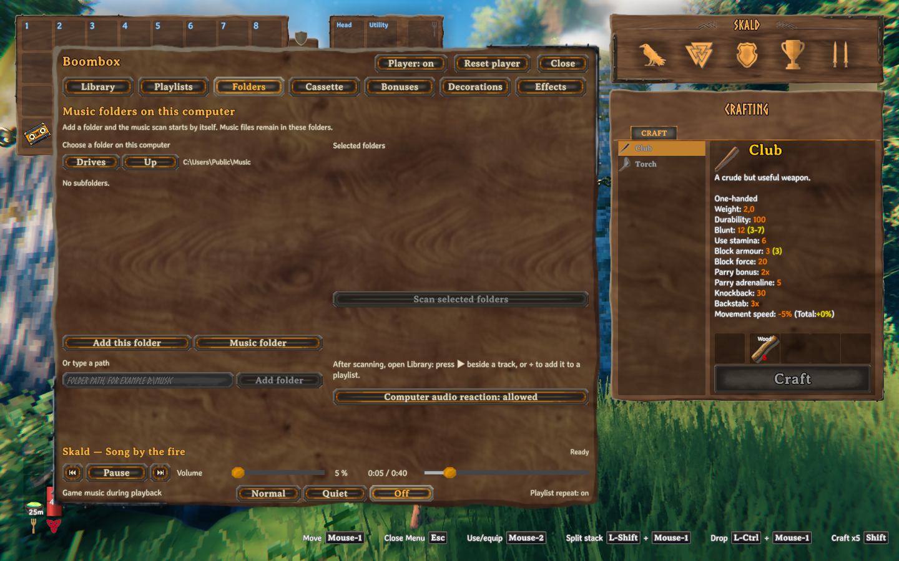
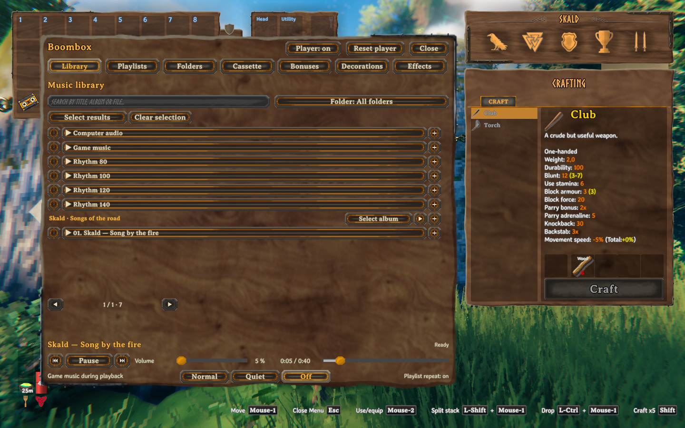
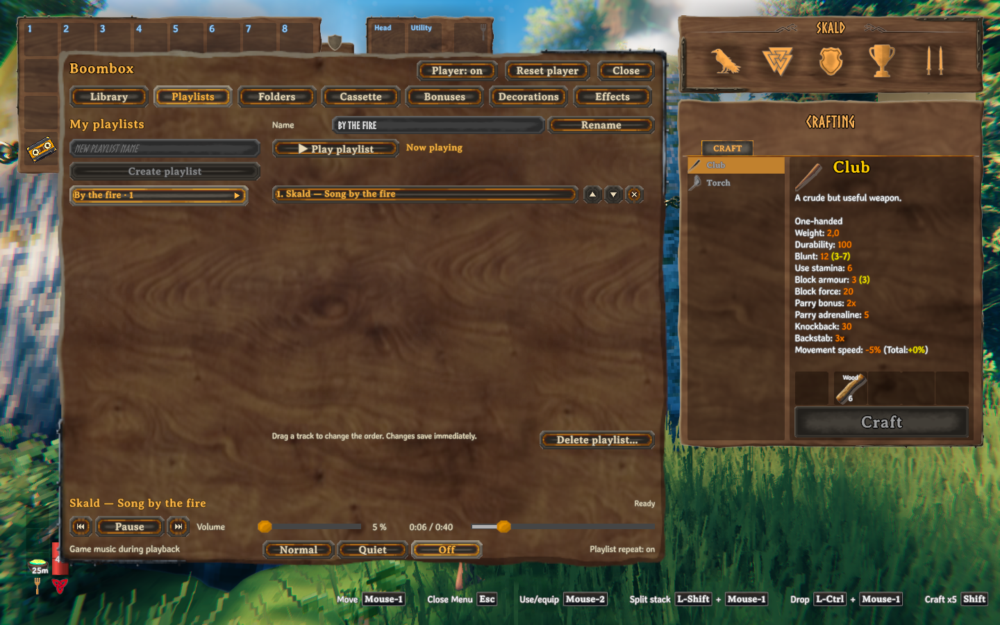
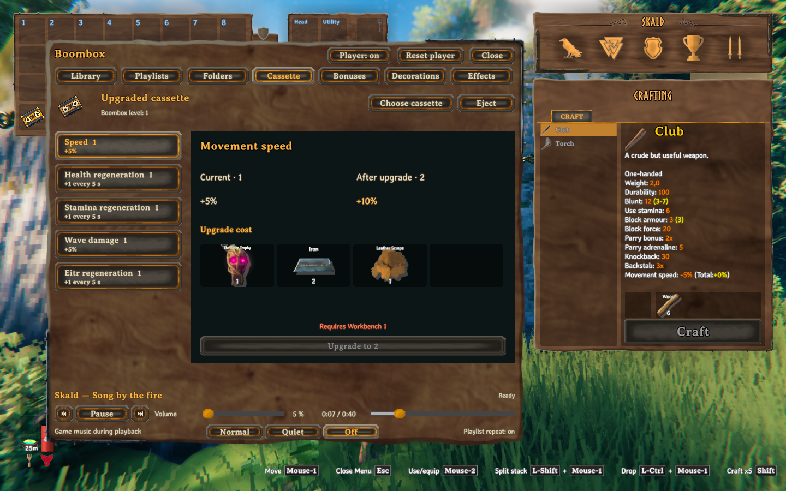
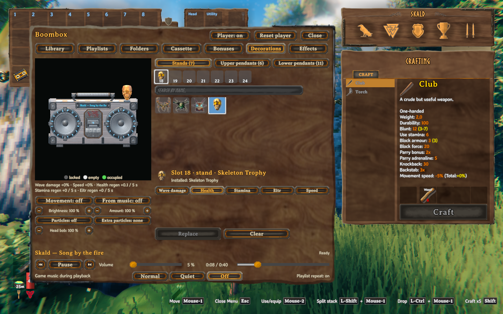
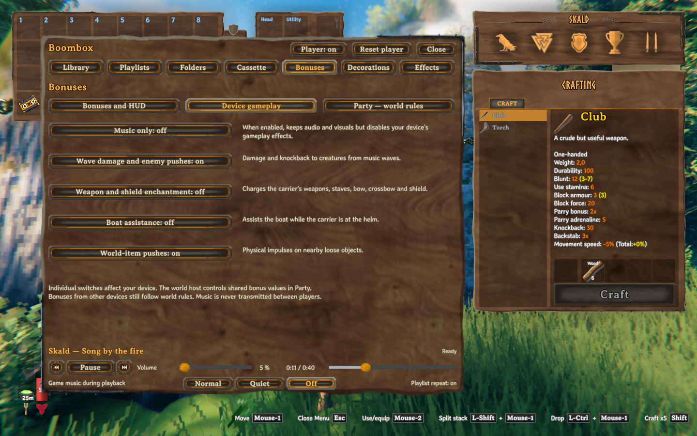
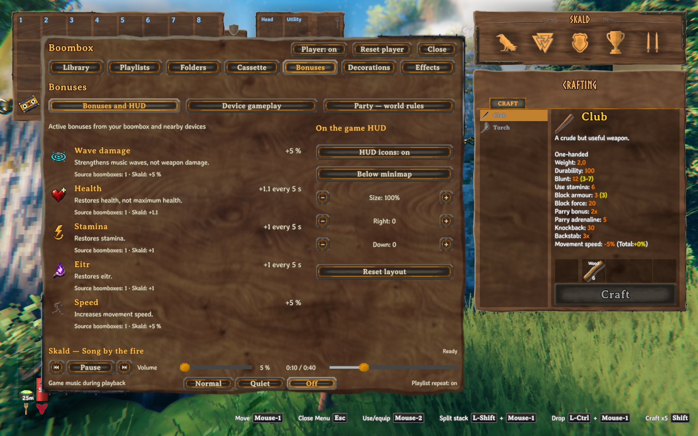
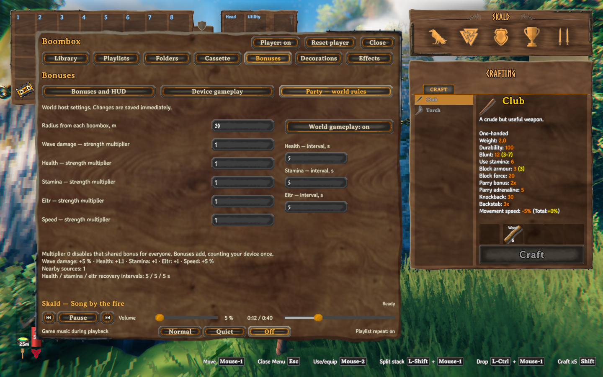
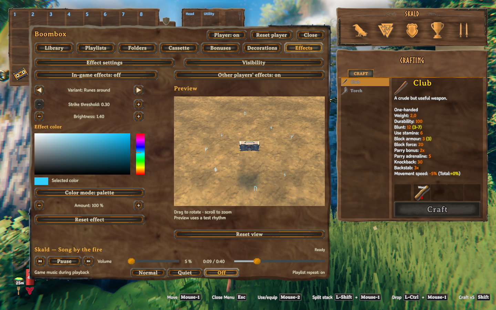

# Play Valheim Boombox

[Русский](PLAY.ru.md) · [Mod overview](README.md)

Windows x64 · 0.2.7

Carry your music, build a decorated boombox, and share its bonuses with nearby players. This guide covers the player interface, progression, combat, appearance, and saved music library. Recipe quantities and balance values below are the defaults.

## Find what you need

- [Install and start your first track](#install-and-start-your-first-track)
- [Use the player and move the device](#use-the-player-and-move-the-device)
- [Build a music library](#build-a-music-library)
- [Choose an audio source](#choose-an-audio-source)
- [Create and edit playlists](#create-and-edit-playlists)
- [Upgrade the device](#upgrade-the-device)
- [Improve a cassette](#improve-a-cassette)
- [Decorate the boombox](#decorate-the-boombox)
- [Use waves and charged equipment](#use-waves-and-charged-equipment)
- [Share bonuses and set world rules](#share-bonuses-and-set-world-rules)
- [Set effects and visibility](#set-effects-and-visibility)
- [Keep your library and solve problems](#keep-your-library-and-solve-problems)

## Install and start your first track

The mod supports Windows x64. Install BepInExPack Valheim 5.4.2351 and use the complete Boombox release ZIP. The release contains the plugin, FFmpeg tools, and their source and licence materials. It contains no music. A source-code ZIP is not an installable mod package.

1. In Gale, r2modman, or Thunderstore Mod Manager, select your Valheim profile with BepInExPack installed.
2. Import the complete release ZIP with the manager's local mod import.
3. Launch Valheim with mods enabled.

For a manual installation, copy the ZIP's `BepInEx` tree into the game's existing BepInEx installation. Keep the package subfolders together. Leave only one copy of the Boombox plugin DLL. Install the same mod version on the server and every client.

Craft and assemble your first player as follows.

1. At Workbench level 1, craft a boombox with 10 Wood, 6 Resin, 2 Leather Scraps, 2 Bone Fragments, and 50 Coins.
2. Craft a basic cassette at the same station with 2 Wood, 1 Resin, and 1 Bone Fragments.
3. Open your inventory. Right-click the cassette to insert it into your carried boombox.
4. Equip the boombox from your inventory. The device appears on your back and leaves your hands free.
5. Click **Boombox** in the inventory to open the boombox menu.
6. Open **Folders**. Select a music folder in the built-in browser and click **Add this folder**. The scan starts automatically.
7. Open **Library**. Click the play button beside a track.

The music starts, the title appears in the player, and the device reacts to the audio. A cassette is required for every source, including computer audio and fixed rhythms. Right-clicking a cassette inserts it. Use the inventory's music button to open the interface.

*Choose a folder and add it without leaving Valheim.*

You can also insert a cassette through **Cassette** → **Choose cassette**. Select a cassette from your backpack. **Boomboxes** selects another device in your inventory when you have more than one.

## Use the player and move the device

The menu has seven tabs.

| Tab | Use it to |
|---|---|
| Library | Find tracks and albums, start playback, and select music for playlists. |
| Playlists | Create, rename, reorder, play, and delete saved playlists. |
| Folders | Add or remove scanned folders, scan again, and enable computer-audio reaction. |
| Cassette | Insert, replace, eject, and upgrade a cassette, or choose a device. |
| Bonuses | See active bonuses, move HUD indicators, and change personal or host gameplay settings. |
| Decorations | Unlock positions and designs, fit decorations, and choose their bonuses and particles. |
| Effects | Preview music effects and control visual visibility. |

The player bar under the menu contains previous track, play or pause, next track, and a volume slider. Drag the position bar to seek when the current source supports seeking. Synthetic sources do not have an ordinary track position. **Game music during playback** controls Valheim's own background music, as described in [Choose an audio source](#choose-an-audio-source).

With your inventory open, the floating player provides previous, play or pause, next, repeat, mute, and volume minus or plus. It remains visible while the Boombox menu is open. Volume changes in 10% steps. Active repeat and mute buttons are highlighted. Repeat loops the current queue. The main menu bar shows the repeat state, while the floating player changes it.

Drag the floating player's title bar to move it. **Boombox** opens the library, and **Bonuses** opens the bonus panel. The floating player hides while the main menu is open and returns when you close it. The menu header's **Player** switch enables or disables the floating panel. **Reset player** enables it and restores its automatic position beside the inventory, including after an interrupted drag. When the panel is disabled, **Boombox** remains available in the inventory. You can drag the main menu by its header and close it with **Close**.

With several devices, the floating player uses your equipped boombox first, otherwise one of your placed devices, otherwise a device in your backpack. Selecting another device in the main menu does not change that priority.

### Wear, put down, and pick up

A worn device follows your character and plays stable, non-spatial audio. A device left unequipped in the backpack is inactive and silent. A device placed in the world plays positional audio. Its default listening distance is 35 metres, separate from the smaller combat radius and the party-bonus radius.

Drop the device from your inventory to put it in the world. To place it on a boat or cart, stand on that vehicle and drop it. The mod looks for free supported space and attaches the device to the vehicle. If no space fits, the device stays in your inventory and a message explains the failure. A device stored inside a container is inactive.

In multiplayer, attachment also needs the game to give your client control of that vehicle. If that transfer fails, the device is dropped without being attached to the vehicle.

For your own placed device, use its interaction prompt to pick it up and equip it. You need enough backpack space. The alternate interaction, **Shift+E** with default game bindings, opens its controls. Playback and settings require the owner to stay within 4 metres of a placed device, even though it can be heard farther away. Another player uses ordinary pickup and does not automatically equip the device or get the owner's alternate controls. Item state travels with the device when it moves between your backpack and the world.

With a compatible Extra Slots installation, the boombox has a dedicated equipment slot. Moving it from that slot to an empty regular backpack cell unequips it and cancels any pending equip action. Moving an unequipped device into the boombox slot queues equip; an already equipped device stays equipped. If the installed Extra Slots version is unsupported, use normal inventory equipment controls. Extra Slots is optional.

### Replace or eject a cassette

In **Cassette**, click **Choose cassette** and select the replacement from your backpack. The old cassette returns to the backpack. You can also right-click a cassette in your inventory to replace the cassette in your carried device.

**Eject** returns the inserted cassette with its saved properties and stops playback. Ejection needs one free regular backpack cell. The playlist and playback position are preserved. An unsuccessful replacement leaves the previous cassette in place when it cannot be returned safely.

## Build a music library

### Add folders and scan

Open **Folders**. The browser runs inside the game. Select a drive, open a folder, and use **Up** to return to its parent. **Music folder** adds your Windows music folder when it exists. Choose **Add this folder** when you reach another folder that contains your music. The browser hides hidden and system folders; you can add an accessible one by typing its path instead.

You can instead enter a path under **Or type a path** and click **Add folder**. For example, enter `D:\Music`. The folder must exist and be accessible. Adding a folder starts a scan of the whole saved folder list and its subfolders. Nested directory links, including junctions and symbolic links, are skipped. Audio files stay where they are.

After adding or changing music, use **Scan selected folders** to scan the whole saved list again. During a scan, use **Cancel scan** to stop it. A cancelled scan does not replace the finished catalogue with partial results. Remove a folder from the saved list when you no longer want it scanned. Its existing catalogue entries remain until the next completed scan. Removing the folder entry does not delete the folder or its music.

Supported extensions are MP3, FLAC, WAV, OGG, APE, WV, M4A, AAC, Opus, and WMA. Decoding depends on the file's actual codec and the included FFmpeg tools. ZIP archives can contain music and CUE sheets. External CUE sheets and embedded CUESHEET metadata split an album image into track entries. Keep the CUE sheet and its referenced audio together. Other archive formats are not scanned.

### Find tracks and albums

In **Library**, use **Search by title, album or file…**. Search also matches the artist when the artist is present in the track label. Use **Folder** to narrow the results to one scanned folder, or return to **All folders**. The library shows 50 results per page. Use the page arrows for later results.

Click a track's play button to start at that track within the current filtered queue. An album has its own play button and selection control. Album playback follows the album's disc and track ordering. A missing or unreadable track is marked unavailable and cannot play.

Select individual tracks, an album, or **Select results**. **Select results** adds every found track, including later pages, to the current selection. Tracks selected outside the current filter stay selected. **Clear selection** removes the selection. **Add selected to playlist…** opens the destination picker. The plus button beside a track or album opens the same choice for that item.

*System sources and local music share the library. The plus buttons add tracks or albums to a playlist.*

## Choose an audio source

The **All folders** view includes local files and the following system sources. Select a source and press play. These sources can also be saved in playlists.

| Source | What the device uses |
|---|---|
| Local track | Plays the selected file through the boombox and analyses it for music events. |
| Computer audio | Analyses sound already playing through the default Windows multimedia output. Your external program plays the sound. |
| Game music | Reacts to Valheim's currently available background music. |
| Rhythm 80, 100, 120, or 140 | Produces steady events at the selected BPM. These are test rhythms, not recorded songs. |

For computer audio, turn on **Computer audio reaction** in **Folders**, select **Computer audio** in the library, and start playback. It analyses the combined output of programs routed to Windows' default multimedia device. It cannot isolate a chosen program. Audio sent to another output is outside that capture. Changing the external program's volume changes what you hear. The mod's reaction sensitivity changes its analysis, not Windows volume.

**Computer audio sensitivity** is an advanced configuration setting, not an in-game slider. Its default is 1 and its range is 0.1–5. In the plugin configuration listed below, use `ComputerAudioSensitivity` in the `[Audio]` section.

Capture runs only while this source is selected and playing and reaction is allowed. The mod does not replay the captured audio, record it to disk, or send it to other players. Muting the boombox's local file player does not mute another program.

The player bar's **Game music during playback** setting has three choices. The default is **Off**.

| Choice | Native Valheim background music while the boombox plays |
|---|---|
| Normal | Keeps its usual volume. |
| Quiet | Uses 20% of its usual volume. |
| Off | Silences it during boombox playback. |

This control leaves combat sounds and your saved game-volume setting unchanged. It changes the game's background music volume and does not choose the boombox's audio source. For **Game music** reaction, the game needs an available music source. Choose **Normal** or **Quiet** to keep that source audible.

Quiet and Off apply while your own device is playing, has a cassette, has volume above zero, and is within hearing distance. Muting the device or setting its volume to zero lets Valheim's music return to its normal level.

## Create and edit playlists

1. Open **Playlists**, enter a name in **New playlist name**, and click **Create playlist**.
2. Open **Library** and select tracks or albums.
3. Click **Add selected to playlist…**, then choose your playlist.
4. Return to **Playlists**, select the playlist on the left, and click **▶ Play playlist**.

You can also create a destination in the library's add-to-playlist picker. The selected tracks are added to the new playlist. When library tracks remain selected, the playlist editor offers **Add selected tracks** for the selected destination.

Select an existing playlist to edit it. Change **Name** and click **Rename**. Use the track arrows or drag a row to change order. Click a row to start playback there. The cross removes that entry. Changes save immediately. A missing source remains identifiable so you can remove it and add its replacement.

To delete a playlist, click **Delete playlist…** and confirm **Delete**. **Cancel** keeps it. Deleting a playlist or a track entry leaves the music files untouched. Use the floating player's repeat button to repeat the queue. Playback follows the saved order.

Deleting a saved playlist does not stop a queue already loaded onto a device. Removing or reordering entries in an existing loaded playlist does update that device's queue.

*Select the playlist, then play it or change its saved order.*

## Upgrade the device

Craft level I at the station below, then use Valheim's crafting-station **Upgrade** tab for each next device level. Bring the device and materials to the required station. Discover the ingredients if the recipe is not visible.

If the device was equipped, the upgraded item is queued to equip again automatically.

Device level controls the wave's base blunt damage, radius, push, and progression appearance. Upgrading does not trigger an attack by itself. The playing cassette and enabled gameplay produce music events.

| Target level | Station level | Default materials | Base blunt damage | Wave radius |
|---|---|---|---:|---:|
| I | Workbench 1 | Wood ×10, Resin ×6, Leather Scraps ×2, Bone Fragments ×2, Coins ×50 | 1 | 3 m |
| II | Forge 1 | Eikthyr Trophy ×1, Bronze ×4, Finewood ×4 | 10 | 3.25 m |
| III | Forge 2 | The Elder Trophy ×1, Iron ×6, Leather Scraps ×4 | 16 | 3.5 m |
| IV | Forge 3 | Bonemass Trophy ×1, Silver ×6, Crystal ×4 | 24 | 3.75 m |
| V | Forge 4 | Moder Trophy ×1, Black Metal ×6, Linen Thread ×4 | 34 | 4 m |
| VI | Black Forge 1 | Yagluth Trophy ×1, Refined Eitr ×4, Black Marble ×6 | 46 | 4.25 m |
| VII | Black Forge 3 | The Queen Trophy ×1, Flametal ×6, Asksvin Hide ×2 | 62 | 4.5 m |
| VIII | Black Forge 4 | Fader Trophy ×1, Bloodgold ×6, Timberwood ×4 | 80 | 4.75 m |

The default maximum craftable level is VIII. The local configuration can lower the limit from I to VIII without removing existing higher-level devices. Recipe materials and stations are also local configuration settings. The server does not synchronize recipes or upgrade caps to clients. Recipe changes take effect after returning to the main menu. The station's displayed requirements take priority over this default table. In multiplayer, the server calculates wave damage and enemy push using its own settings.

The base push strength reaches its highest default value at level VII and stays the same at VIII. Damage and radius still increase at VIII.

## Improve a cassette

There is one basic cassette with five independent properties. Each property starts at rank 0 and can reach VII by default. The cassette menu lists each property and its rank. They are not five separately crafted cassette types.

1. Insert the cassette and open **Cassette**.
2. Select a property on the left.
3. Compare its current and next values. Check the station and materials shown below them.
4. Stand at the required station and click **Upgrade to …** for the next rank.

Only the selected property advances one rank. You keep the same cassette, its other properties, and saved music. Each property uses the same sequence of recipes, so improving all five properties costs five sets of that sequence.

*The workshop shows the selected property's next rank and its complete cost before you upgrade.*

### Property values at the default balance

| Property | Colour | Rank 0 | Each rank I through VII |
|---|---|---|---|
| Wave damage | Red | 0% | +5% per rank, up to +35%. Applies to musical waves. |
| Health regeneration | Green | 0 | Restores 1 health per rank every 5 seconds, up to 7. |
| Stamina regeneration | Yellow | 0 | Restores 1 stamina per rank every 5 seconds, up to 7. |
| Eitr regeneration | Blue | 0 | Restores 1 eitr per rank every 5 seconds, up to 7. Requires a positive maximum eitr. |
| Movement speed | Purple | 0% | +5% per rank, up to +35%. |

For a single property, the default rank values are as follows. Each recovery column is the amount restored every 5 seconds.

| Rank | Wave damage | Health | Stamina | Eitr | Movement speed |
|---|---:|---:|---:|---:|---:|
| 0 | 0% | 0 | 0 | 0 | 0% |
| I | +5% | 1 | 1 | 1 | +5% |
| II | +10% | 2 | 2 | 2 | +10% |
| III | +15% | 3 | 3 | 3 | +15% |
| IV | +20% | 4 | 4 | 4 | +20% |
| V | +25% | 5 | 5 | 5 | +25% |
| VI | +30% | 6 | 6 | 6 | +30% |
| VII | +35% | 7 | 7 | 7 | +35% |

Recovery restores missing resources. It does not increase their maximum. These properties apply while the device is an active playing source and gameplay is enabled. Nearby sources and decorations can add to the displayed total. The host controls shared bonus strengths, recovery amounts and intervals. The cassette upgrade cap is a local configuration setting from I to VII, with VII as the default. It is not synchronized by the server.

### Default recipe for each selected property

The basic cassette costs Wood ×2, Resin ×1, and Bone Fragments ×1 at Workbench level 1. Every property upgrade below also requires Workbench level 1.

Even with a local recipe override, a basic cassette requires Bone Fragments. The mod adds one if the override leaves them out. This exception does not apply to property-upgrade recipes.

| Target rank | Default materials |
|---|---|
| I | Eikthyr Trophy ×1, Bronze ×1, Finewood ×1 |
| II | The Elder Trophy ×1, Iron ×2, Leather Scraps ×1 |
| III | Bonemass Trophy ×1, Silver ×2, Crystal ×1 |
| IV | Moder Trophy ×1, Black Metal ×2, Linen Thread ×1 |
| V | Yagluth Trophy ×1, Refined Eitr ×1, Black Marble ×2 |
| VI | The Queen Trophy ×1, Flametal ×2, Asksvin Hide ×1 |
| VII | Fader Trophy ×1, Bloodgold ×2, Timberwood ×1 |

## Decorate the boombox

There are 24 positions. **Stands** contains 7 upper trophy stands. **Upper pendants** contains 6 hanging positions, three on each side. **Lower pendants** contains 11, seven along the front and two on each side. The preview's markers distinguish locked, empty, and occupied positions.

1. Open **Decorations** and choose a group.
2. Select a numbered position, or click its marker on the preview.
3. If locked, check its price and click **Unlock slot** at Workbench level 1.
4. Find a design in the catalogue. **Search by name** filters the known designs that fit the selected group.
5. If necessary, click **Unlock design** with the displayed materials and station available.
6. Click **Install**, or **Replace** for an occupied position.

Slot 1, the first lower front pendant, is already unlocked and selected when you first open **Decorations**. The seven trophy stands start locked. Position numbers run from 1 to 24 across the groups. By default, the next position costs 0 Coins, then subsequent positions cost 50, 100, 150, and so on. The price depends on how many positions are already unlocked, not their position numbers. Every slot unlock requires Workbench level 1, including a free unlock.

The local plugin configuration sets the first purchased slot's price, the increase for each later purchase, and an optional price cap. These values are not synchronized by the server. A zero cap means no cap. The price is the start price plus the step times the number of prior purchases, with a minimum of zero. The menu shows the price of your next unlock.

The miniature boombox and cassette designs are unlocked by default, including on existing devices. They never consume your boombox or cassette. For other item or trophy designs, the default unlock cost is one copy of that object, Wood ×2, and Resin ×1 at Workbench level 1. A miniature building design unlocks without material cost once you know its building recipe. A design unlock belongs to that device and can be reused in its compatible positions. Installing another copy of an unlocked design does not consume another trophy.

**Clear** removes the installed appearance from a position and keeps its slot and design unlocked. To put a design elsewhere, select another compatible position and install it there. Clear the old position if you want only one copy. There is no drag-to-move decoration operation.

### Choose appearance, bonus, and particles

The catalogue includes eligible trophy heads, Yellow Mushroom, selected items, and miniature building objects. Trophy stands accept the eligible standing heads. Pendants also accept hanging designs and miniatures. Only known designs with usable models appear. The catalogue reflects the objects available in your game.

Select an installed decoration to choose **Wave damage**, **Health**, **Stamina**, **Eitr**, or **Speed**. Its initial bonus follows the design's default, but you can change it independently of appearance. Replacing its appearance preserves the selected bonus and particle choices.

At default balance, each decoration assigned to wave damage or speed adds 0.25%. Each assigned to health, stamina, or eitr adds 0.1 resource to that recovery tick, normally every 5 seconds. These values add to the cassette contribution. The totals below the decoration preview show only this device's potential decoration contribution after world multipliers. They exclude the cassette and other devices. Open **Bonuses** for the full currently active total.

**Particles** toggles that decoration's bonus particles. **Extra particles** cycles between none, coins, and notes. Some miniature producers emit particles shaped like their products. These shapes and the coin particles are cosmetic. You cannot pick them up, and miniature buildings do not produce crafting materials. Coin and product particles normally appear every 2 seconds and last 4 seconds.

Use **Brightness** and **Amount** to adjust pendant and equipment-enchantment particles from 25% to 300%. **Head bob** controls the heads' musical motion from 0% to 300%. All three controls use 25-percentage-point steps and default to 100%. **Movement** switches decoration movement, while **From music** controls its reaction to the rhythm; both start on. Rotate the preview by dragging, zoom with the wheel, and use **Reset view** to return the camera.

*Appearance, bonus, and particles are separate choices for the selected position.*

*A closer view of the carved body, hanging trophy heads, and miniature boombox.*

## Use waves and charged equipment

### Musical waves

A playing device can damage nearby enemies on emitted music events. You do not need to attack or block first. Waves deal blunt damage at the radius shown in the device-level table. The cassette's red property and damage decorations increase musical-wave damage. They do not add that same percentage to ordinary weapon attacks. Wave hits exclude players and tamed creatures. Only eligible smaller enemies receive the push. Bosses, larger enemies, and enemies in an attack or dodge can take damage without that push.

Before the target's defences apply, a wave hit is the device's base damage multiplied by event strength (0–1) and by one plus the total wave-damage bonus. Musical waves do not build stagger.

Open **Bonuses** → **Device gameplay** to toggle **Wave damage and enemy pushes**. **World-item pushes** is a separate switch for physical impulses on dropped items. It excludes trees, placed buildings, boats, and carts. By default, each item has a 1-second cooldown and gains no more than 2 m/s from a push. Ownership checks also apply. It is not a way to demolish structures or propel a boat.

### Equipment charge

Wear the playing boombox and enable **Weapon and shield enchantment** under **Bonuses** → **Device gameplay**. A device placed nearby can share its aura, but your equipment charge requires your own worn player.

Every third emitted music event supplies one charge step. Each step adds 25%, so full charge needs four steps. The benefits below scale with the charge available when used. Stopping playback, disabling gameplay, or losing the worn source clears the effect. Switching away from charged melee gear, a staff, or a crossbow makes its charge decay at 50% per second.

| Equipment | How to build and use charge | Benefit at full charge |
|---|---|---|
| Bow | Keep the bow drawn during charge events, then fire. Releasing the draw without firing clears its charge. | +20% arrow damage. |
| Shield | Block during charge events. Charge decays at 50% per second after you stop blocking. | 30% lower block stamina cost. |
| Melee weapon | Hold the weapon through charge events and land a melee attack. A missed swing keeps the charge. | +20% damage for the charged landed attack. |
| Staff | Hold the staff through charge events, then start an attack. A successfully started attack spends charge. | 30% lower eitr cost for that attack. |
| Crossbow | Hold the crossbow through charge events, then reload. | 30% shorter reload time when the charged reload is used. |
| Axe or pickaxe on resources | Reach full charge, then hit an intact tree, log, or mining resource. | A ghost tool repeats the captured resource hit after 0.5 seconds if the struck resource is still intact. |
| Thrown spear | Reach full charge while holding the spear, then throw it into a character. | A ghost spear repeats the captured hit after 0.2 seconds if the target is still alive. |

An axe uses the ordinary melee bonus against suitable combat targets. Resource hits use the separate ghost-tool rule. A pickaxe receives ghost resource strikes rather than the ordinary melee damage bonus. A spear also works as charged melee equipment when you thrust with it. The delayed ghost strike spends its charge when it actually strikes. A destroyed resource or dead spear target cannot receive the repeat hit.

Hiding hand and weapon effects also hides ghost models and trails. It leaves charge and the delayed strikes enabled.

### Boat assistance

Enable **Boat assistance** in **Bonuses** → **Device gameplay**. Wear the playing device and steer the moving boat with a speed setting other than Stop. The boat must already be moving horizontally at 0.5 m/s or more. This is the activation threshold, not an amount of extra speed. Music events restore part of the speed lost to water drag, along the boat's current horizontal movement.

The wave and trail at the sail are decorative. Use **Effects** → **Visibility** → **All world visuals** to hide them while keeping boat assistance enabled. Turning off **Boat assistance** disables the assistance itself.

*Keep the music while choosing which gameplay actions your device may perform.*

## Share bonuses and set world rules

### Read your active bonuses

Open **Bonuses** → **Bonuses and HUD**. The five rows show current wave damage, health recovery, stamina recovery, eitr recovery, and movement speed. Each row includes source information and its contribution. Recovery rows show both the amount and the interval. The HUD tooltip shows how many devices supply that bonus and groups contributions by owner.

An active source needs a playing cassette, a worn or world-placed device, and enabled gameplay. An unequipped backpack device is inactive. Playback paused by storage, a dead owner, or teleporting does not supply an active source. A party source does not need line of sight.

By default, sources within 20 metres add together. Each device is counted once. A device's cassette contribution and its decorations add first, then the world's multiplier for that property applies. Multiple source contributions then add for the recipient. The hearing distance of placed music and the combat-wave radius are separate values.

For example, one cassette at movement rank II contributes 10% by default. Four speed decorations on the same device contribute another 1%. With the world's speed multiplier at 1, that source supplies 11% while active and in range. Another active source can add its own contribution. Recovery stops at your missing resource amount, and eitr recovery requires a positive eitr maximum.

*Read the amounts and recovery intervals here instead of guessing from an icon.*

### Personal gameplay settings

Under **Device gameplay**, **Music only** keeps your audio and visuals but disables gameplay actions from your own device. It does not mute your music. Bonuses from other devices still follow the world's rules.

When personal gameplay is allowed, the individual switches control wave damage and enemy push, equipment enchantment, boat assistance, and world item pushes. A visual visibility switch cannot disable these mechanics. If the host disables world gameplay, the page shows that the individual actions are off by mode.

### Host settings

Open **Bonuses** → **Party — world rules**. The host can edit the shared radius, the five strength multipliers, and the separate health, stamina, and eitr recovery intervals. Changes save immediately. Radius and multipliers accept nonnegative numbers. A multiplier of 0 disables that shared bonus. Recovery intervals must be positive.

The default radius is 20 metres. All five multipliers default to 1, and all three recovery intervals default to 5 seconds. **World gameplay** disables gameplay for everyone when switched off, while music and visuals remain. Clients can view the server's values but cannot edit them. A missing server balance appears as a waiting state.

*The host sets shared values; other players can inspect them.*

### Place the HUD indicators

Use **Bonuses and HUD** to show or hide **HUD icons**. Choose an anchor below the minimap, left of the minimap, at the top left, or at the bottom right. **Size** changes scale from 70% to 150% in 10% steps. **Right** and **Down** move the block in 10-unit steps within ±600 UI units. **Reset layout** restores below the minimap, zero offset, and 100% size. Hiding the HUD changes display only.

## Set effects and visibility

Open **Effects** → **Effect settings**. Use the arrows to choose **Sparks**, **Runes around**, **Strike**, **Fixed cracks**, or **Pulse**. The preview uses a test rhythm, so you can judge the effect without waiting for a song's beat.

Adjust the available controls with minus and plus. **Strike threshold** ranges from 0.30 to 0.90 in 0.05 steps and is hidden for Pulse. **Brightness** ranges from 0 to 3 in 0.05 steps. The amount control runs from 25% to 200%. Sparks and Runes around use the full range; Strike and Fixed cracks cap their rendered amount at 100%, even if the control is higher. Pulse has no amount control. The amount setting is shared between variants. Controls that do not apply to the selected effect are hidden.

For colour, pick a hue on the vertical strip and saturation and brightness in the large square. The swatch shows the selection. Where available, **Color mode** cycles **palette**, **loudness**, and **frequency bands**. Picking your own colour selects palette. Drag the preview to rotate it, use the wheel to zoom, and click **Reset view** for the camera. **Reset effect** restores the selected effect's settings to their defaults. For an amount-enabled variant, it also resets the shared amount used by the other variants.

*Change the effect and colour while watching the preview on the right.*

Open **Visibility** for the complete display switches.

| Switch | What it controls |
|---|---|
| All world visuals | Master switch for the device's world visual effects. |
| Music effect | The selected musical ground or surrounding effect. |
| Speaker effects | Visual effects emitted at the speakers. |
| Speaker movement | Speaker membrane movement. |
| Hand and weapon charge effects | Charge particles, ghost models, and their trails. |
| Body glow | Illumination on the device body. |
| Carving glow | Illumination on its carved panels. |
| Decoration particles | Bonus, extra, and product particles on decorations. |
| Decoration movement | Motion of hanging decorations. |
| Mushroom glow | Glowing mushroom decorations. |
| Pattern pulsing | The musical pulse of the body pattern. |
| Other players' effects | Music effects from other players. |
| Cassette reel rotation | Rotation of the cassette reels. |

These switches hide visuals. Music, weapon charge, damage, and shared bonuses keep following gameplay settings. Hiding another player's effects does not stop that player's device.

**All world visuals** also hides the boat's sail wave and trail. Boat assistance continues while this visual is hidden.

*The speaker membrane during playback.*

## Keep your library and solve problems

### Additional configuration

The in-game pages cover everyday controls. The plugin configuration also contains advanced settings for the device and world. An optional BepInEx configuration editor can show the mod's translated setting names and descriptions. Without an editor, back up the configuration file listed below before editing it with the game closed.

| Area | Additional settings |
|---|---|
| Sound | Placed-device hearing distance, streaming buffer length, decoder program paths, and computer-audio sensitivity (default 1, range 0.1–5). |
| Body appearance | Body, rune, and carving glow colours and brightness; the body pattern colour and pulsing. |
| Speakers | Membrane travel and speaker-front size and duration. |
| Decorations | Mushroom glow strength and the interval and lifetime of coin-shaped and product-shaped particles. |
| Back attachment | Body fitting, equipment clearance, position, and rotation. |
| World progression | Recipe materials and stations, maximum device and cassette levels, decoration-position prices, and recovery balance. |
| Dropped-item physics | Push strength, radius multiplier, mass and item-count limits, cooldown, and maximum speed change. |

These are optional adjustments. They are not prerequisites for opening the menu or playing music. Crafting requirements reflect the local recipe configuration. Shared bonus readouts reflect the host's balance settings.

The `[World physics]` defaults are `PressureImpulse = 20`, `RadiusMultiplier = 1`, `MaximumMass = 0`, `MaximumBodies = 0`, `PushCooldown = 1`, and `MaxSpeedChange = 2`. Zero mass and item-count limits mean no configured cap on those values. The cooldown is in seconds and maximum speed change is in metres per second.

If your device's gameplay stays off while the server allows it, also check `MusicOnly` in your local `[Gameplay]` configuration. A true value disables your own device's gameplay even when the received world rules allow it.

### Local files, language, and privacy

Each player hears their own audio. Music files and computer-audio capture stay local. The game network carries device appearance and gameplay data. Use the same mod version on all peers. A client without the required mod gets Valheim's connection rejection, and the server log records the version it requires.

The interface follows Valheim's selected language. English and Russian cover menus, items, tooltips, and setting labels. Other languages fall back to English when no mod translation is available. A game-language change updates the text. Your track names, folder paths, and saved settings do not change.

The mod does not include music or grant rights to music you play in a stream or video.

### Paths and backups

Paths are relative to the active BepInEx installation or mod-manager profile.

| Path | Contents |
|---|---|
| `BepInEx/config/ValheimBoombox/library.json` | Added folders, playlists, and remembered track metadata. |
| `BepInEx/config/ValheimBoombox/catalog.json` | Results of the last completed scan. |
| `BepInEx/config/ValheimBoombox/` | Other local Boombox state and backup files. |
| `BepInEx/config/local.valheim.boombox.cfg` | Plugin settings, including decoder paths and optional shortcuts. |
| `Tools/FFmpeg/` beside the plugin DLL | Bundled `ffmpeg.exe` and `ffprobe.exe`. |

The music files remain in your selected folders. Device progression, decorations, and cassette data also travel in the game's saved item data. Before moving installations or restoring a setup, close the game and back up the Boombox config directory, its plugin configuration, your music, and the normal Valheim character and world saves. Keep those backups together. Moving music to another path can leave old playlist entries unavailable. Scan the new location, remove missing entries, and add the new ones.

### Fix a problem

| Problem | What to check |
|---|---|
| The mod does not appear | Launch the modded profile. Check BepInEx, the complete release package, and duplicate plugin DLLs. |
| A recipe is missing | Discover its ingredients. Check the required station, its level, and the recipe and progression limits in your local configuration. |
| The inventory music button is absent | Acquire a boombox so the character knows it, then reopen the inventory. Extra Slots is not required. |
| Nothing plays | Insert a cassette, equip or place the device, start playback, and inspect volume and mute. Check that the source exists. |
| A track is unavailable | Restore its original file path or scan the new folder and replace its playlist entry. Keep CUE references and audio together. |
| Decoding fails | Use the complete package with its FFmpeg tools. Check `FFmpegPath` and `FFprobePath` in the plugin config if tools were moved. A filename extension does not guarantee a valid codec. |
| A scan is slow | Scan only the folders you need. **Cancel scan** stops the current search. |
| Computer audio does not react | Play the **Computer audio** source, enable its reaction in **Folders**, and check Windows' default multimedia output and the external player's volume. |
| Game music does not react | Check that Valheim currently has a music source available. |
| Visuals are absent | Check **All world visuals**, the individual **Visibility** switches, effect brightness, and the selected source's activity. |
| Charge is absent | Wear your own playing device, insert a cassette, enable enchantment, and check personal and host gameplay rules. Hold the relevant gear through charge events. |
| Bonuses are absent | Check cassette ranks, installed decoration bonuses, active playback, range, and the host's world settings. Rank 0 has no cassette contribution. |
| Ejection fails | Free one ordinary backpack cell. |
| A vehicle placement fails | Clear space on a supported surface near your character. The message leaves the device in your backpack. |
| A dedicated slot is absent | Use ordinary inventory equipment controls. The installed Extra Slots version may be unsupported. |
| A server rejects the connection | Match the server's mod version and inspect its log for the required version. |

For a bug report, include game and mod versions, other installed mods, the steps, and expected and actual results. Add a screenshot or short clip for a visual problem. Remove private paths, account identifiers, and music-library details from a BepInEx log before sharing it. Do not attach your personal library or game saves publicly.

### Optional shortcuts

The inventory buttons provide the normal visible route into the interface. The default configurable shortcuts are **F7** for the menu and **F4** for play or pause. The `boombox` console command is another menu entry point. The plugin config stores the shortcut settings.
