# Игра с Valheim Boombox

[English](PLAY.md) · [Обзор мода](README.ru.md)

Windows x64 · 0.2.7

Носите свою музыку, собирайте украшенный магнитофон и делитесь его бонусами с игроками поблизости. Здесь описаны интерфейс, улучшения, бой, оформление и сохранённая музыкальная библиотека. Все приведённые цены и значения баланса стандартные.

## Найти нужный раздел

- [Установить мод и включить первый трек](#установить-мод-и-включить-первый-трек)
- [Управлять плеером и перемещать аппарат](#управлять-плеером-и-перемещать-аппарат)
- [Собрать музыкальную библиотеку](#собрать-музыкальную-библиотеку)
- [Выбрать источник звука](#выбрать-источник-звука)
- [Создать и изменить плейлист](#создать-и-изменить-плейлист)
- [Улучшить аппарат](#улучшить-аппарат)
- [Улучшить кассету](#улучшить-кассету)
- [Украсить магнитофон](#украсить-магнитофон)
- [Использовать волны и заряд снаряжения](#использовать-волны-и-заряд-снаряжения)
- [Получать общие бонусы и менять правила мира](#получать-общие-бонусы-и-менять-правила-мира)
- [Настроить эффекты и видимость](#настроить-эффекты-и-видимость)
- [Сохранить библиотеку и решить проблемы](#сохранить-библиотеку-и-решить-проблемы)

## Установить мод и включить первый трек

Мод работает на Windows x64. Установите BepInExPack Valheim 5.4.2351 и используйте полный установочный ZIP Boombox. Он содержит плагин, программы FFmpeg, их исходники и материалы лицензии. Музыки в пакете нет. ZIP с исходным кодом не является установочным пакетом.

1. В Gale, r2modman или Thunderstore Mod Manager выберите профиль Valheim с установленным BepInExPack.
2. Импортируйте полный установочный ZIP через импорт локального мода.
3. Запустите Valheim с включёнными модами.

Для ручной установки скопируйте дерево `BepInEx` из ZIP в существующую установку BepInEx игры. Сохраните подпапки пакета. Оставьте одну копию DLL плагина Boombox. Серверу и всем клиентам нужна одинаковая версия мода.

Соберите первый плеер следующим образом.

1. На станции «Верстак» уровня 1 создайте магнитофон. Нужны «Древесина» ×10, «Смола» ×6, «Кожаные обрывки» ×2, «Обломки костей» ×2 и «Монеты» ×50.
2. Там же создайте обычную кассету. Нужны «Древесина» ×2, «Смола» ×1 и «Обломки костей» ×1.
3. Откройте инвентарь. Нажмите правой кнопкой на кассету, чтобы вставить её в переносной магнитофон.
4. Наденьте магнитофон через инвентарь. Аппарат появится на спине и оставит руки свободными.
5. Нажмите **Выбрать музыку** в инвентаре, чтобы открыть меню магнитофона.
6. Перейдите в **Папки**. Выберите музыкальную папку во встроенном обозревателе и нажмите **Добавить эту папку**. Поиск начнётся автоматически.
7. Откройте **Библиотеку**. Нажмите кнопку воспроизведения у трека.

Начнётся музыка, в плеере появится название, а аппарат станет реагировать на звук. Кассета нужна для любого источника, включая звук компьютера и фиксированный ритм. Правый щелчок по кассете вставляет её. Меню открывает музыкальная кнопка в инвентаре.

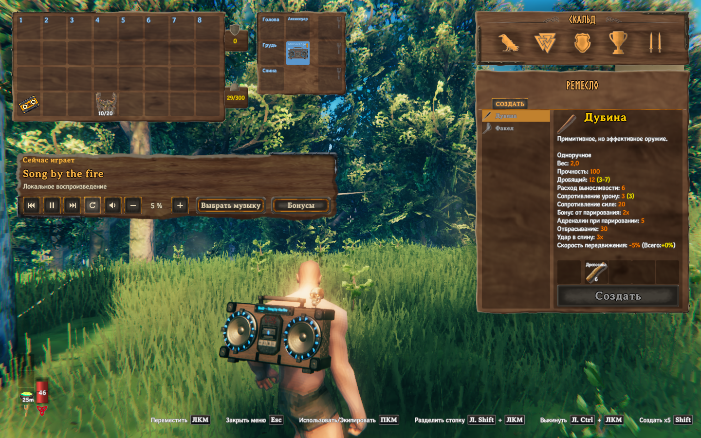

*Откройте инвентарь и нажмите «Выбрать музыку». Запоминать горячую клавишу не требуется.*

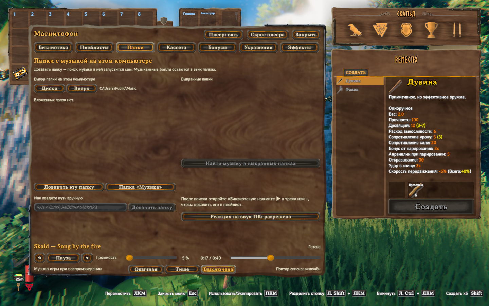

*Выберите папку и добавьте её, не выходя из Valheim.*

Можно вставить кассету через **Кассета** → **Выбрать кассету**. Выберите её в списке содержимого рюкзака. Кнопка **Магнитофоны** позволяет выбрать другой аппарат из инвентаря, если у вас их несколько.

## Управлять плеером и перемещать аппарат

В меню семь вкладок.

| Вкладка | Для чего нужна |
|---|---|
| Библиотека | Найти трек или альбом, начать воспроизведение и выбрать музыку для плейлиста. |
| Плейлисты | Создать, переименовать, упорядочить, воспроизвести и удалить плейлист. |
| Папки | Добавить или убрать папку, повторить поиск и разрешить реакцию на звук компьютера. |
| Кассета | Вставить, заменить, извлечь и улучшить кассету либо выбрать аппарат. |
| Бонусы | Посмотреть действующие бонусы, переместить индикаторы и изменить личные либо общие игровые настройки. |
| Украшения | Открыть места и образцы, установить украшения, выбрать их бонусы и частицы. |
| Эффекты | Посмотреть музыкальные эффекты и настроить видимость оформления. |

Панель под меню содержит предыдущий трек, воспроизведение или паузу, следующий трек и ползунок громкости. Перетаскивайте полосу позиции для перемотки, когда выбранный источник её поддерживает. У синтетического источника нет обычной позиции трека. Переключатель **Музыка игры при воспроизведении** управляет фоновой музыкой Valheim. Его варианты описаны в разделе [Выбрать источник звука](#выбрать-источник-звука).

При открытом инвентаре плавающий плеер предлагает предыдущий трек, воспроизведение или паузу, следующий трек, повтор, отключение звука и кнопки громкости. Он остаётся видимым и при открытом меню магнитофона. Громкость меняется с шагом 10%. Включённые повтор и отключение звука подсвечиваются. Повтор зацикливает текущую очередь. Основная панель показывает его состояние, а переключается он на плавающем плеере.

Перетащите плавающий плеер за заголовок. **Выбрать музыку** открывает библиотеку, а **Бонусы** открывают панель бонусов. Переключатель **Плеер** в заголовке меню показывает или скрывает эту плавающую панель. **Сброс плеера** включает её и возвращает к автоматическому положению возле инвентаря, в том числе после незавершённого перетаскивания. При скрытом плеере кнопка **Выбрать музыку** остаётся в инвентаре. Главное меню тоже можно переместить за заголовок. Кнопка **Закрыть** закрывает его.

Если аппаратов несколько, плавающий плеер сначала управляет надетым, затем одним из ваших установленных в мире аппаратов, затем аппаратом в рюкзаке. Выбор другого магнитофона в главном меню не меняет этот приоритет.

### Надеть, поставить и подобрать

Надетый аппарат следует за персонажем и воспроизводит стабильный непространственный звук. Снятый аппарат в рюкзаке неактивен и молчит. Установленный в мире аппарат воспроизводит позиционный звук. Стандартная дальность слышимости составляет 35 метров. Она задаётся отдельно от меньшего радиуса боевой волны и от радиуса общих бонусов.

Выбросьте аппарат из инвентаря, чтобы поставить его в мире. Для установки на лодке или телеге встаньте на неё и выбросьте аппарат. Мод найдёт свободную опору и закрепит магнитофон на транспорте. Если подходящего места нет, аппарат останется в инвентаре, а сообщение объяснит причину. Аппарат внутри контейнера неактивен.

В сетевой игре крепление также требует передачи управления транспортом вашему клиенту. Если передача не удалась, аппарат выпадет без крепления к транспорту.

Используйте подсказку взаимодействия у собственного установленного аппарата, чтобы подобрать и надеть его. В рюкзаке должно хватать места. Дополнительное действие, **Shift+E** при стандартных клавишах игры, открывает управление. Владелец может менять воспроизведение и настройки установленного аппарата в пределах 4 метров, хотя звук слышен дальше. Другой игрок подбирает аппарат обычным действием, без автоматического надевания и дополнительного управления владельца. Состояние предмета сохраняется при переносе между рюкзаком и миром.

При совместимом Extra Slots у магнитофона есть отдельная ячейка снаряжения. Перенос из неё в пустую обычную ячейку рюкзака снимает аппарат и отменяет ожидающее надевание. Перенос снятого аппарата в ячейку магнитофона ставит надевание в очередь; уже надетый аппарат остаётся надетым. Если версия Extra Slots не поддерживается, используйте обычное управление снаряжением в инвентаре. Extra Slots необязателен.

### Заменить или извлечь кассету

Во вкладке **Кассета** нажмите **Выбрать кассету** и выберите замену из рюкзака. Прежняя кассета вернётся в рюкзак. Для замены кассеты в переносном аппарате можно также нажать правой кнопкой на новую кассету в инвентаре.

**Извлечь** возвращает вставленную кассету с её свойствами и останавливает воспроизведение. Нужна одна свободная обычная ячейка рюкзака. Плейлист и позиция воспроизведения сохраняются. Если при замене прежнюю кассету нельзя безопасно вернуть в рюкзак, она остаётся в аппарате.

## Собрать музыкальную библиотеку

### Добавить папки и найти музыку

Откройте **Папки**. Обозреватель работает внутри игры. Выберите диск, откройте нужный каталог и используйте **Вверх** для перехода к родительскому. Кнопка **Папка «Музыка»** добавляет музыкальную папку Windows, если она существует. В другой нужной музыкальной папке нажмите **Добавить эту папку**. Скрытые и системные папки не показаны в обозревателе; доступную папку можно добавить вводом пути.

Можно ввести путь под надписью **Или введите путь вручную** и нажать **Добавить папку**. Например, укажите `D:\Музыка`. Папка должна существовать и быть доступной. Добавление запускает поиск по всему сохранённому списку папок и их вложенным каталогам. Вложенные ссылки на каталоги, включая символические ссылки и точки соединения, пропускаются. Музыка остаётся на прежнем месте.

После добавления или изменения файлов нажмите **Найти музыку в выбранных папках**, чтобы повторно проверить весь сохранённый список. Во время поиска кнопка **Отменить поиск** останавливает его. Отмена не заменяет готовый каталог частичными результатами. Уберите папку из сохранённого списка, если больше не хотите её сканировать. Её прежние треки останутся в каталоге до следующего завершённого поиска. Удаление записи из списка не удаляет каталог и музыку с диска.

Поддерживаются расширения MP3, FLAC, WAV, OGG, APE, WV, M4A, AAC, Opus и WMA. Возможность воспроизведения зависит от настоящего кодека файла и комплектных программ FFmpeg. ZIP может содержать музыку и CUE. Внешние CUE и встроенные данные CUESHEET разбивают образ альбома на отдельные записи треков. Храните CUE рядом с аудиофайлами, на которые он ссылается. Другие форматы архивов не сканируются.

### Найти трек или альбом

В **Библиотеке** используйте **Поиск по названию, альбому или файлу…**. Поиск также находит исполнителя, если он указан в подписи трека. Фильтр **Папка** ограничивает результаты одним каталогом. **Все папки** возвращает полный список. На странице отображается 50 результатов. Стрелки страниц показывают остальные.

Кнопка воспроизведения у трека запускает текущую отфильтрованную очередь с этого трека. У альбома есть собственные кнопки выбора и воспроизведения. Альбом играет в порядке дисков и треков. Отсутствующий или нечитаемый источник отмечается как недоступный и не воспроизводится.

Выберите отдельные треки, альбом или **Выбрать найденные**. Последняя кнопка добавляет все найденные треки, включая другие страницы, к текущему выделению. Ранее выбранные треки вне текущего фильтра остаются выбранными. **Снять выбор** очищает выделение. **Добавить выбранные в плейлист…** открывает выбор назначения. Плюс у трека или альбома делает то же для этой записи.

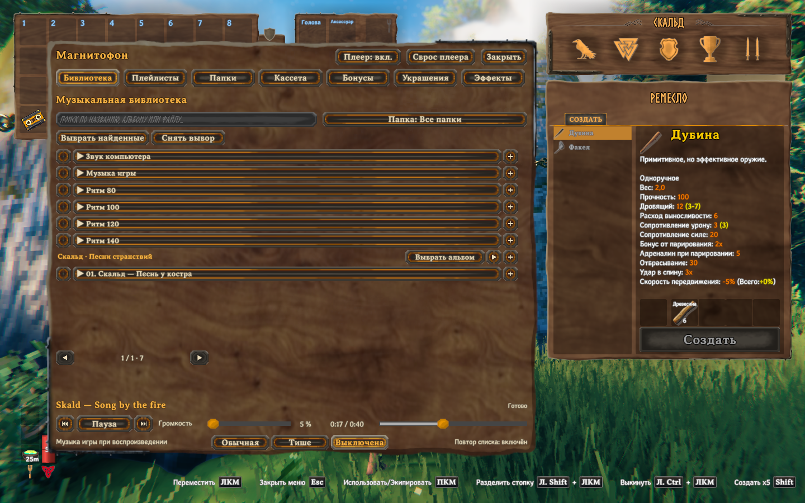

*Системные источники и локальная музыка находятся в одной библиотеке. Кнопки «+» добавляют трек или альбом в плейлист.*

## Выбрать источник звука

В режиме **Все папки** доступны локальные файлы и следующие системные источники. Выберите источник и включите воспроизведение. Их также можно добавлять в плейлисты.

| Источник | Что использует аппарат |
|---|---|
| Локальный трек | Воспроизводит файл через магнитофон и анализирует его музыкальные события. |
| Звук компьютера | Анализирует уже звучащий общий вывод стандартного мультимедийного устройства Windows. Сам звук воспроизводит внешняя программа. |
| Музыка игры | Реагирует на доступную в данный момент фоновую музыку Valheim. |
| Ритм 80, 100, 120 или 140 | Создаёт равномерные события с выбранным числом ударов в минуту. Это тестовый ритм, а не записанная песня. |

Для звука компьютера включите **Реакция на звук ПК** в **Папках**. Выберите **Звук компьютера** в библиотеке и начните воспроизведение. Анализируется общий звук программ, направленный на стандартное мультимедийное устройство Windows. Выбрать одну программу нельзя. Звук с другого устройства вывода не попадёт в этот анализ. Громкость внешнего проигрывателя меняет то, что вы слышите. Чувствительность реакции мода меняет анализ, а не громкость Windows.

**Чувствительность к звуку компьютера** задаётся в расширенной конфигурации, отдельного ползунка в игровом меню нет. Стандартное значение равно 1, допустимый диапазон составляет 0,1–5. В конфигурации плагина, указанной ниже, используйте ключ `ComputerAudioSensitivity` в разделе `[Audio]`.

Захват работает только при выбранном и воспроизводимом источнике с разрешённой реакцией. Мод не воспроизводит захваченный звук повторно, не записывает его на диск и не передаёт другим игрокам. Отключение звука файлового плеера магнитофона не выключает другую программу.

У настройки **Музыка игры при воспроизведении** на панели плеера три варианта. По умолчанию выбрано **Выключена**.

| Вариант | Фоновая музыка Valheim во время работы магнитофона |
|---|---|
| Обычная | Сохраняет обычную громкость. |
| Тише | Играет на 20% от обычной громкости. |
| Выключена | Не звучит во время воспроизведения магнитофона. |

Настройка сохраняет боевые звуки и записанное значение громкости игры. Она меняет фоновую музыку Valheim и не выбирает источник магнитофона. Для реакции на **Музыку игры** у самой игры должен быть доступен музыкальный источник. Выберите **Обычная** или **Тише**, чтобы оставить этот источник слышимым.

Варианты «Тише» и «Выключена» действуют, пока ваш аппарат играет со вставленной кассетой, его громкость выше нуля и вы находитесь в пределах слышимости. При отключении звука аппарата или нулевой громкости музыка Valheim возвращается к обычному уровню.

## Создать и изменить плейлист

1. Откройте **Плейлисты**, заполните **Название нового плейлиста** и нажмите **Создать плейлист**.
2. В **Библиотеке** выберите треки или альбомы.
3. Нажмите **Добавить выбранные в плейлист…** и выберите свой список.
4. Вернитесь в **Плейлисты**, выберите список слева и нажмите **▶ Воспроизвести**.

Новый список можно создать и в окне добавления из библиотеки. Выбранные треки попадут в него. Если в библиотеке остались выделенные записи, редактор плейлиста предлагает **Добавить выбранные треки** в текущий список.

Выберите существующий плейлист для редактирования. Измените **Название** и нажмите **Переименовать**. Стрелки у трека или перетаскивание строки меняют порядок. Нажатие строки запускает её воспроизведение. Крестик убирает запись. Изменения сохраняются сразу. Недоступный источник остаётся различимым, чтобы вы могли убрать его и добавить замену.

Для удаления списка нажмите **Удалить плейлист…**, затем **Удалить**. **Отмена** сохраняет его. Удаление плейлиста или его строки не затрагивает музыкальные файлы. Кнопка повтора на плавающем плеере зацикливает очередь. Треки играют в сохранённом порядке.

Удаление сохранённого плейлиста не останавливает очередь, уже загруженную в аппарат. Удаление или перестановка треков в существующем загруженном плейлисте обновляет очередь этого аппарата.

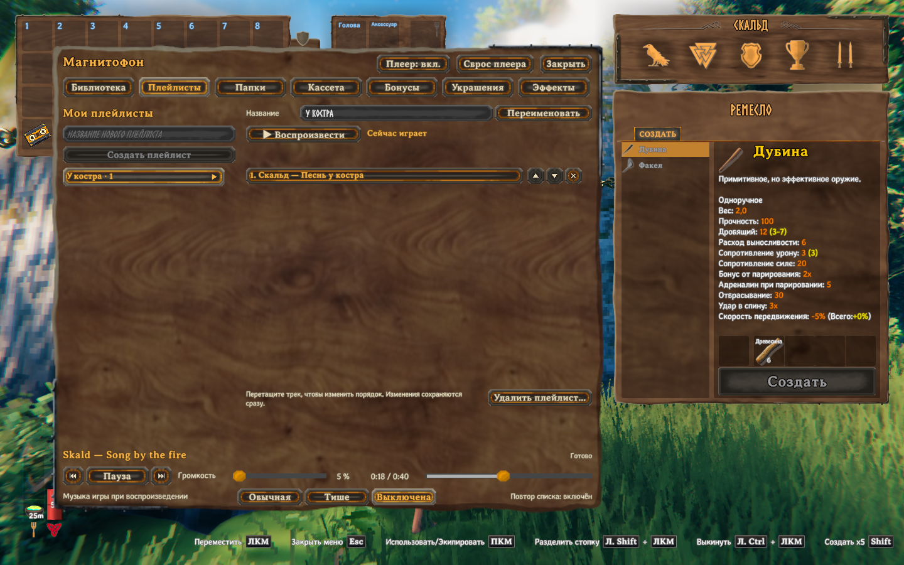

*Выберите плейлист, чтобы включить его или изменить сохранённый порядок треков.*

## Улучшить аппарат

Создайте аппарат уровня I на указанной ниже станции. Для каждого следующего уровня используйте вкладку **Улучшение** на подходящей ремесленной станции. Принесите аппарат и материалы. Если рецепт не виден, откройте нужные ингредиенты.

Если аппарат был надет, после улучшения система автоматически ставит его повторное надевание в очередь.

Уровень задаёт базовый дробящий урон, радиус, толчок волны и внешний вид развития. Само улучшение не запускает атаку. Музыкальные события создаёт играющая кассета при разрешённых игровых эффектах.

| Целевой уровень | Станция и уровень | Стандартные материалы | Базовый дробящий урон | Радиус волны |
|---|---|---|---:|---:|
| I | Верстак 1 | Древесина ×10, Смола ×6, Кожаные обрывки ×2, Обломки костей ×2, Монеты ×50 | 1 | 3 м |
| II | Кузница 1 | Трофей: Эйктюр ×1, Бронза ×4, Качественная древесина ×4 | 10 | 3,25 м |
| III | Кузница 2 | Трофей: Древний ×1, Железо ×6, Кожаные обрывки ×4 | 16 | 3,5 м |
| IV | Кузница 3 | Трофей: Масса костей ×1, Серебро ×6, Кристалл ×4 | 24 | 3,75 м |
| V | Кузница 4 | Трофей: Матерь ×1, Черный металл ×6, Льняная нить ×4 | 34 | 4 м |
| VI | Черная кузница 1 | Трофей: Яглут ×1, Переработанный эйтр ×4, Черный мрамор ×6 | 46 | 4,25 м |
| VII | Черная кузница 3 | Трофей: Королева ×1, Огнеметалл ×6, Шкура пеплозавра ×2 | 62 | 4,5 м |
| VIII | Черная кузница 4 | Трофей: Прародитель ×1, Кровавое золото ×6, Древесина северной ели ×4 | 80 | 4,75 м |

Стандартный предел создания составляет VIII. Локальная конфигурация позволяет ограничить его уровнем от I до VIII, сохранив уже существующие аппараты более высокого уровня. Материалы и станции рецептов также настраиваются локально. Сервер не передаёт рецепты и пределы улучшений клиентам. Правки рецептов действуют после возврата в главное меню. Требования, показанные станцией, имеют приоритет перед этой стандартной таблицей. В мультиплеере сервер рассчитывает урон волн и толчок противников по своим настройкам.

Базовая сила толчка достигает стандартного максимума на уровне VII и остаётся такой же на VIII. Урон и радиус на VIII продолжают расти.

## Улучшить кассету

У обычной кассеты пять независимых свойств. Каждое начинается с ранга 0 и по умолчанию развивается до VII. Цветные знаки обозначают свойство. Это не пять отдельных типов кассет для изготовления.

1. Вставьте кассету и откройте **Кассету**.
2. Выберите свойство слева.
3. Сравните текущее и следующее значения. Проверьте станцию и материалы под ними.
4. Подойдите к нужной станции и нажмите **Улучшить до …**, чтобы получить следующий ранг.

Только выбранное свойство получает один ранг. Остальные свойства, сохранённая музыка и сама кассета остаются прежними. Для каждого свойства используется одинаковая последовательность рецептов. Развитие всех пяти требует пяти комплектов этой последовательности.

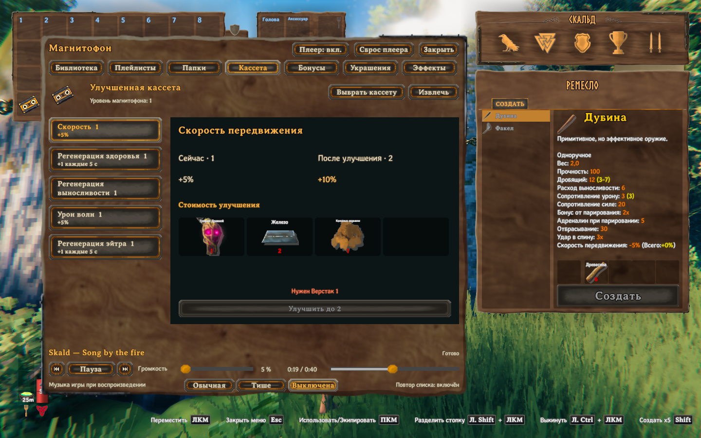

*Мастерская показывает следующий ранг выбранного свойства и полную стоимость до улучшения.*

### Значения свойств при стандартном балансе

| Свойство | Цвет | Ранг 0 | Ранги от I до VII |
|---|---|---|---|
| Урон волн | Красный | 0% | +5% за ранг, до +35%. Усиливает музыкальные волны. |
| Регенерация здоровья | Зелёный | 0 | Восстанавливает 1 здоровье за ранг каждые 5 секунд, до 7. |
| Регенерация выносливости | Жёлтый | 0 | Восстанавливает 1 выносливость за ранг каждые 5 секунд, до 7. |
| Регенерация эйтра | Синий | 0 | Восстанавливает 1 эйтр за ранг каждые 5 секунд, до 7. Нужен положительный максимум эйтра. |
| Скорость передвижения | Фиолетовый | 0% | +5% за ранг, до +35%. |

Для отдельного свойства стандартные значения по рангам следующие. В столбцах восстановления указано количество ресурса каждые 5 секунд.

| Ранг | Урон волн | Здоровье | Выносливость | Эйтр | Скорость передвижения |
|---|---:|---:|---:|---:|---:|
| 0 | 0% | 0 | 0 | 0 | 0% |
| I | +5% | 1 | 1 | 1 | +5% |
| II | +10% | 2 | 2 | 2 | +10% |
| III | +15% | 3 | 3 | 3 | +15% |
| IV | +20% | 4 | 4 | 4 | +20% |
| V | +25% | 5 | 5 | 5 | +25% |
| VI | +30% | 6 | 6 | 6 | +30% |
| VII | +35% | 7 | 7 | 7 | +35% |

Восстановление пополняет недостающие ресурсы и не повышает их максимум. Свойства работают, когда аппарат служит активным играющим источником и игровые эффекты разрешены. Другие источники поблизости и украшения прибавляются к общему значению. Хозяин мира управляет силой общих бонусов, величинами и интервалами восстановления. Предел улучшения кассеты задаётся локальной настройкой от I до VII, по умолчанию VII. Сервер его не синхронизирует.

### Стандартный рецепт выбранного свойства

Для обычной кассеты нужны «Древесина» ×2, «Смола» ×1 и «Обломки костей» ×1 на станции «Верстак» уровня 1. Каждое улучшение ниже тоже требует станцию «Верстак» уровня 1.

Даже при изменении рецепта в локальной конфигурации обычная кассета требует обломки костей. Мод добавляет одну единицу, если их убрали из рецепта. Для рецептов улучшения свойств такого исключения нет.

| Целевой ранг | Стандартные материалы |
|---|---|
| I | Трофей: Эйктюр ×1, Бронза ×1, Качественная древесина ×1 |
| II | Трофей: Древний ×1, Железо ×2, Кожаные обрывки ×1 |
| III | Трофей: Масса костей ×1, Серебро ×2, Кристалл ×1 |
| IV | Трофей: Матерь ×1, Черный металл ×2, Льняная нить ×1 |
| V | Трофей: Яглут ×1, Переработанный эйтр ×1, Черный мрамор ×2 |
| VI | Трофей: Королева ×1, Огнеметалл ×2, Шкура пеплозавра ×1 |
| VII | Трофей: Прародитель ×1, Кровавое золото ×2, Древесина северной ели ×1 |

## Украсить магнитофон

Всего предусмотрено 24 места. **Стойки** содержат 7 верхних мест для голов. **Верхние подвесы** содержат 6 мест, по три с каждого бока. **Нижние подвесы** содержат 11, семь спереди и по два с каждого бока. Метки предпросмотра различают закрытые, пустые и занятые места.

1. Откройте **Украшения** и выберите группу.
2. Выберите номер места или нажмите его метку в предпросмотре.
3. Если место закрыто, проверьте цену и нажмите **Открыть место** на станции «Верстак» уровня 1.
4. Найдите образец в каталоге. **Поиск по названию** оставляет знакомые образцы для выбранной группы.
5. Если нужно, нажмите **Открыть вид**, имея показанные материалы и доступ к станции.
6. Нажмите **Установить** или **Заменить** для занятого места.

Место 1, первый нижний передний подвес, уже открыто и выбрано при первом открытии **Украшений**. Все семь стоек для трофеев изначально закрыты. Места имеют общую нумерацию от 1 до 24. Следующее место по умолчанию бесплатно. Затем цена составляет 50, 100, 150 монет и далее. Цена зависит от числа уже открытых мест, а не от их номеров. Каждое открытие требует станцию «Верстак» уровня 1, включая бесплатное.

Цена первой покупки, прибавка за каждую следующую и необязательный потолок задаются в локальной конфигурации плагина. Сервер эти значения не синхронизирует. Нулевой потолок означает отсутствие ограничения. К начальной цене прибавляется шаг, умноженный на число предыдущих покупок. Результат не бывает меньше нуля. Меню показывает цену следующего места.

Виды миниатюрного магнитофона и кассеты открыты сразу, в том числе у существующих аппаратов. Они не расходуют ваш магнитофон или кассету. Образец другого предмета или трофея по умолчанию требует одну копию выбранного объекта, «Древесина» ×2 и «Смола» ×1 на станции «Верстак» уровня 1. Образец миниатюрной постройки открывается без материалов, когда вам известен её строительный рецепт. Открытый образец относится к этому аппарату и повторно используется в подходящих местах. Ещё одна установка открытого образца не расходует новый трофей.

**Освободить** снимает оформление, сохраняя открытое место и образец. Для переноса вида выберите другое подходящее место и установите его там. Освободите прежнее место, если нужна только одна копия. Перетаскивания украшения между местами нет.

### Выбрать вид, бонус и частицы

Каталог содержит подходящие головы трофеев, предмет «Желтый гриб», избранные предметы и миниатюрные постройки. Стойки принимают подходящие головы. Подвесы также принимают висячие образцы и миниатюры. Появляются только известные образцы с доступной моделью. Состав каталога зависит от объектов вашей игры.

Выберите установленное украшение, чтобы назначить **Урон волн**, **Здоровье**, **Выносливость**, **Эйтр** или **Скорость**. Начальный бонус определяется образцом. Позже его можно менять независимо от вида. Замена внешнего вида сохраняет выбранный бонус и настройки частиц.

При стандартном балансе каждое украшение урона волн или скорости добавляет 0,25%. Украшение здоровья, выносливости или эйтра добавляет 0,1 ресурса к соответствующему восстановлению, обычно каждые 5 секунд. Эти величины складываются со вкладом кассеты. Итоги под предпросмотром показывают только потенциальный вклад украшений этого аппарата после мировых множителей, без кассеты и других аппаратов. Полная действующая сумма находится во вкладке **Бонусы**.

**Частицы** включает частицы бонуса этого украшения. **Доп. частицы** перебирает отсутствие частиц, монеты и ноты. Некоторые миниатюрные производители показывают частицы в виде своей продукции. Эти фигурки и монетные частицы декоративные. Их нельзя подобрать, а миниатюрные постройки не производят материалы. Монетные и продуктовые частицы обычно появляются раз в 2 секунды и живут 4 секунды.

Кнопки **Яркость** и **Количество** регулируют частицы подвесов и усиления снаряжения от 25% до 300%. **Качание голов** меняет музыкальное движение голов от 0% до 300%. Шаг всех трёх настроек составляет 25 процентных пунктов, стандартное значение равно 100%. **Движение** переключает движение украшений, а **От музыки** управляет реакцией на ритм. Оба переключателя изначально включены. Перетаскивайте предпросмотр для вращения и используйте колесо для масштаба. **Сбросить вид** возвращает камеру.

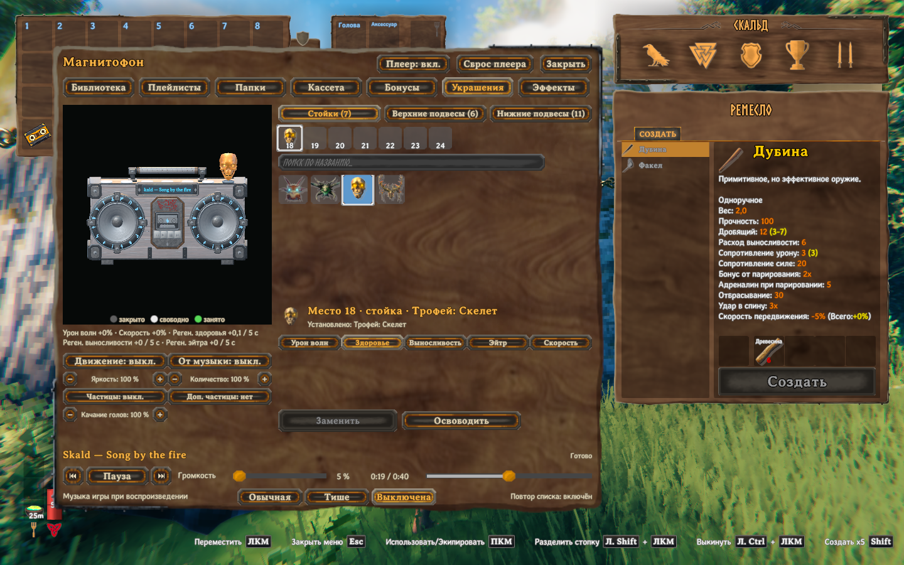

*Внешний вид, бонус и частицы выбираются отдельно для выбранного места.*

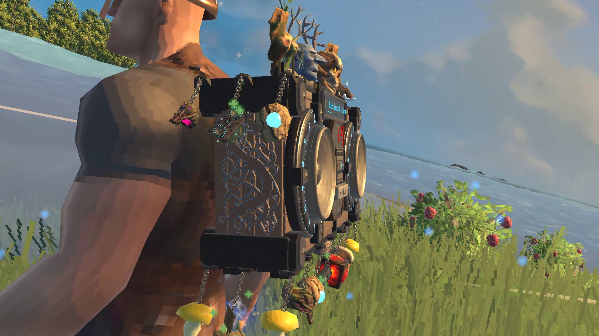

*Резной корпус, подвешенные головы трофеев и миниатюрный магнитофон крупным планом.*

## Использовать волны и заряд снаряжения

### Музыкальные волны

Играющий аппарат может наносить урон ближайшим врагам по музыкальным событиям. Предварительно атаковать или блокировать не нужно. Волны наносят дробящий урон в радиусе, указанном в таблице уровней аппарата. Красное свойство кассеты и украшения урона усиливают музыкальные волны. Этот процент не прибавляется к обычным атакам оружием. Волны не поражают игроков и приручённых существ. Толчок действует только на подходящих небольших врагов. Боссы, крупные враги и существа во время атаки или уклонения могут получать урон без толчка.

До применения защиты цели урон волны равен базовому урону аппарата, умноженному на силу события (от 0 до 1) и на единицу плюс общий бонус урона волн. Музыкальные волны не заполняют шкалу оглушения.

Откройте **Бонусы** → **Настройки аппарата**, чтобы переключить **Урон волн и толчки врагов**. **Толчки предметов** отдельно управляют воздействием на брошенные предметы. Оно не применяется к деревьям, поставленным постройкам, лодкам и телегам. По умолчанию один предмет толкается не чаще раза в секунду, а изменение скорости от толчка не превышает 2 м/с. Также проверяется владелец объекта. Волнами нельзя сносить здания или двигать лодку.

### Заряд снаряжения

Наденьте играющий магнитофон и включите **Усиление оружия и щита** в **Бонусы** → **Настройки аппарата**. Стоящий рядом аппарат делится общей аурой, но заряд снаряжения требует собственного надетого плеера.

Каждое третье музыкальное событие даёт шаг заряда. Шаг добавляет 25%, поэтому полный заряд требует четырёх шагов. Эффект зависит от заряда на момент применения. Остановка воспроизведения, отключение игровых действий или потеря надетого источника очищают эффект. После смены заряженного ближнего оружия, посоха или арбалета его заряд убывает на 50% в секунду.

| Снаряжение | Как накопить и использовать заряд | Эффект при полном заряде |
|---|---|---|
| Лук | Держите лук натянутым во время шагов заряда, затем стреляйте. Отмена натяжения очищает заряд. | +20% к урону стрелы. |
| Щит | Блокируйте во время шагов заряда. После прекращения блока заряд убывает на 50% в секунду. | Расход выносливости на блок ниже на 30%. |
| Оружие ближнего боя | Держите оружие во время шагов заряда и попадите атакой. Промах сохраняет заряд. | +20% к урону заряженной попавшей атаки. |
| Посох | Держите посох во время шагов заряда и начните атаку. Успешный запуск тратит заряд. | Расход эйтра на эту атаку ниже на 30%. |
| Арбалет | Держите арбалет во время шагов заряда, затем перезарядите его. | Заряженная перезарядка короче на 30%. |
| Топор или кирка по ресурсу | Накопите полный заряд и ударьте целое дерево, бревно или добываемый ресурс. | Призрачный инструмент повторяет записанное попадание через 0,5 секунды, если ресурс ещё цел. |
| Брошенное копьё | Накопите полный заряд с копьём в руках, затем бросьте его в персонажа. | Призрачное копьё повторяет попадание через 0,2 секунды, если цель ещё жива. |

Топор получает обычный бонус ближнего боя по подходящим боевым целям. Удары по ресурсам используют отдельное правило призрачного инструмента. Кирка получает призрачный удар по ресурсу вместо обычного бонуса ближнего урона. Копьё также работает как заряженное ближнее оружие при уколе. Отложенный призрачный удар расходует заряд, когда действительно попадает. Уничтоженный ресурс или погибшая цель копья не получают повторное попадание.

Скрытие эффектов рук и оружия также убирает призрачные модели и следы. Заряд и отложенные удары остаются включены.

### Помощь лодке

Включите **Помощь лодке** в **Бонусы** → **Настройки аппарата**. Наденьте играющий аппарат и управляйте движущейся лодкой в режиме скорости кроме остановки. Горизонтальная скорость корабля уже должна составлять не менее 0,5 м/с. Это порог включения помощи, а не прибавка скорости. Музыкальные события возвращают часть скорости, потерянной из-за сопротивления воды, по направлению текущего горизонтального движения лодки.

Волна и след у паруса декоративные. В разделе **Эффекты** → **Видимость** выключите **Все эффекты в мире**, чтобы скрыть их, сохранив помощь движению. Переключатель **Помощь лодке** отключает саму помощь.

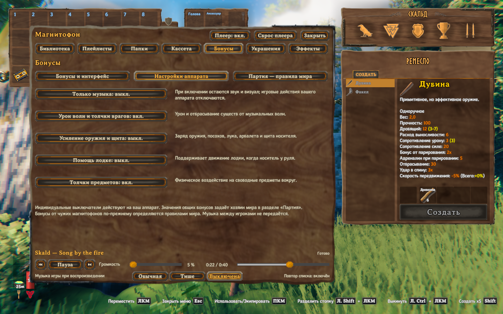

*Оставьте музыку и выберите, какие игровые действия может выполнять ваш аппарат.*

## Получать общие бонусы и менять правила мира

### Посмотреть действующие бонусы

Откройте **Бонусы** → **Бонусы и интерфейс**. Пять строк показывают текущий урон волн, восстановление здоровья, выносливости и эйтра, а также скорость передвижения. В строках есть сведения об источниках и их вкладе. Для восстановления указаны величина и интервал. Подсказка индикатора показывает число аппаратов для этого бонуса и группирует вклад по владельцам.

Для активного источника нужны играющая кассета, надетый или установленный в мире аппарат и разрешённые игровые эффекты. Снятый аппарат в рюкзаке неактивен. Приостановка в хранилище, смерть владельца или телепортация прекращают действие источника. Прямая видимость для общих бонусов не нужна.

По умолчанию источники в пределах 20 метров складываются. Каждый аппарат учитывается один раз. Сначала складываются кассета и украшения аппарата, затем применяется мировой множитель этого свойства. После этого складываются вклады всех источников для получателя. Дальность слышимости установленной музыки и радиус боевой волны задаются отдельно.

Например, кассета со скоростью ранга II даёт 10% при стандартном балансе. Четыре украшения скорости добавляют ещё 1%. При мировом множителе скорости 1 этот активный источник даёт 11% в пределах радиуса. Другой активный источник добавляет свой вклад. Восстановление ограничено недостающим ресурсом, а восстановлению эйтра нужен положительный максимум эйтра.

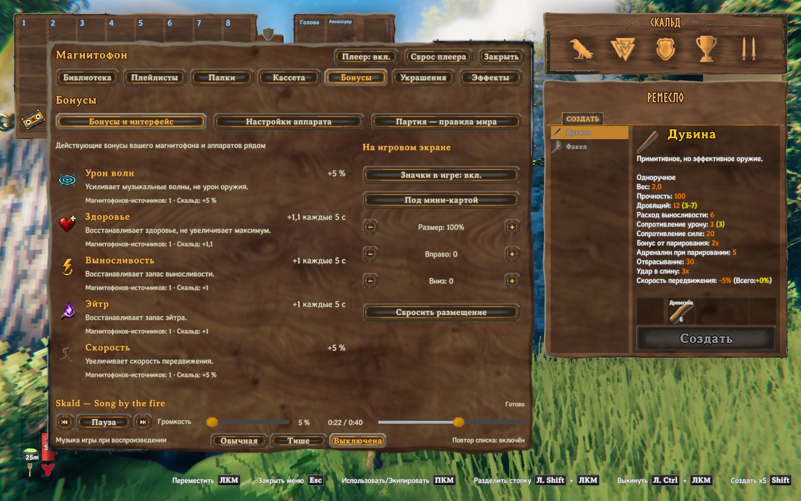

*Здесь видны значения и периоды восстановления, их не нужно угадывать по иконке.*

### Личные игровые настройки

В **Настройках аппарата** режим **Только музыка** сохраняет звук и оформление, но отключает игровые действия собственного аппарата. Он не заглушает музыку. Бонусы чужих аппаратов продолжают подчиняться правилам мира.

Когда личные игровые действия разрешены, отдельные переключатели управляют уроном волн и толчками врагов, усилением снаряжения, помощью лодке и толчками предметов. Переключатель видимости не отключает эти механики. Если хозяин отключил игровые эффекты мира, страница показывает, что отдельные действия выключены режимом.

### Настройки хозяина мира

Откройте **Бонусы** → **Партия — правила мира**. Хозяин может изменить общий радиус, пять множителей силы и отдельные интервалы восстановления здоровья, выносливости и эйтра. Изменения сохраняются сразу. Радиус и множители принимают неотрицательные числа. Множитель 0 выключает этот общий бонус. Интервал восстановления должен быть положительным.

Стандартный радиус составляет 20 метров. Все пять множителей равны 1, три интервала восстановления равны 5 секундам. Выключение **Игровые эффекты мира** отключает игровые действия для всех, сохраняя музыку и оформление. Клиенты видят серверные значения, но не могут их изменить. Пока баланс сервера не получен, отображается ожидание.

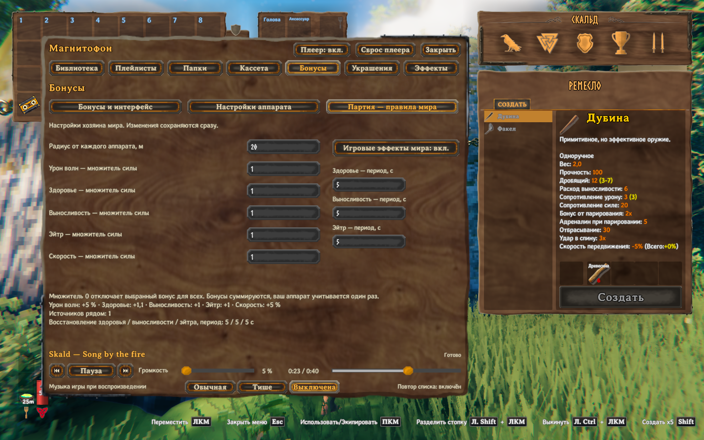

*Хозяин задаёт общие значения, остальные игроки могут их посмотреть.*

### Разместить индикаторы

В **Бонусы и интерфейс** переключите **Значки в игре**. Выберите привязку под миникартой, слева от неё, в левом верхнем или правом нижнем углу. **Размер** меняет масштаб от 70% до 150% с шагом 10%. **Вправо** и **Вниз** сдвигают блок с шагом 10 в пределах ±600 единиц интерфейса. **Сбросить размещение** возвращает положение под миникартой, нулевое смещение и размер 100%. Скрытие индикаторов меняет только отображение.

## Настроить эффекты и видимость

Откройте **Эффекты** → **Настройка эффекта**. Стрелки выбирают **Искры**, **Руны вокруг**, **Удар**, **Трещины на месте** или **Пульс**. Предпросмотр использует тестовый ритм. Можно увидеть результат, не дожидаясь удара в песне.

Меняйте доступные значения кнопками минуса и плюса. **Порог ударов** меняется от 0,30 до 0,90 с шагом 0,05 и скрыт для Пульса. **Яркость** меняется от 0 до 3 с шагом 0,05. Регулятор количества допускает от 25% до 200%. «Искры» и «Руны вокруг» используют весь диапазон; у «Удара» и «Трещин на месте» видимое количество ограничено 100%, даже если регулятор выше. У «Пульса» этого регулятора нет. Значение количества общее для разных вариантов. Неприменимые к выбранному варианту поля скрыты.

Выберите оттенок на вертикальной полосе, а насыщенность и яркость на большой палитре. Образец показывает выбранный цвет. Там, где доступен **Режим цвета**, он перебирает **из палитры**, **по громкости** и **по частотам**. Выбор своего цвета включает палитру. Перетаскивайте предпросмотр для вращения, меняйте масштаб колесом и нажмите **Сбросить ракурс** для камеры. **Сбросить эффект** возвращает стандартные настройки выбранного варианта. Если у варианта есть регулятор количества, сбрасывается и общее значение количества для остальных вариантов.

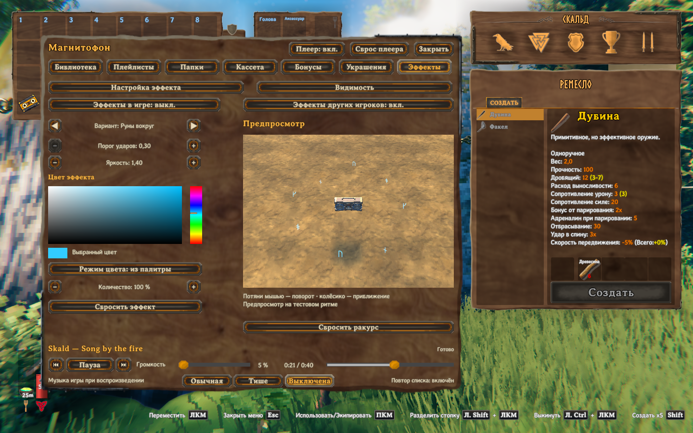

*Меняйте эффект и цвет, наблюдая результат в предпросмотре справа.*

Откройте **Видимость** для полного списка переключателей.

| Переключатель | Чем управляет |
|---|---|
| Все эффекты в мире | Общая видимость оформления аппарата в мире. |
| Музыкальный эффект | Выбранный музыкальный эффект на земле или вокруг. |
| Эффекты у динамиков | Эффекты, исходящие от динамиков. |
| Движение динамиков | Движение мембран. |
| Эффекты усиления рук и оружия | Частицы заряда, призрачные модели и их следы. |
| Свечение корпуса | Подсветка корпуса аппарата. |
| Свечение резьбы | Подсветка резных панелей. |
| Знаки свойств кассеты | Светящиеся обозначения свойств кассеты. |
| Частицы обвесов | Частицы бонуса, дополнительные и продуктовые частицы украшений. |
| Качание обвесов | Движение подвешенных украшений. |
| Свечение грибов | Свечение грибных украшений. |
| Пульсация узора | Музыкальная пульсация узора корпуса. |
| Эффекты других игроков | Музыкальные эффекты других игроков. |
| Вращение катушек | Вращение катушек кассеты. |

Эти переключатели скрывают оформление. Музыка, заряд оружия, урон и общие бонусы продолжают подчиняться игровым настройкам. Скрытие чужих эффектов не останавливает чужой аппарат.

Переключатель **Все эффекты в мире** также скрывает волну и след у паруса лодки. Помощь движению продолжает работать при скрытом оформлении.

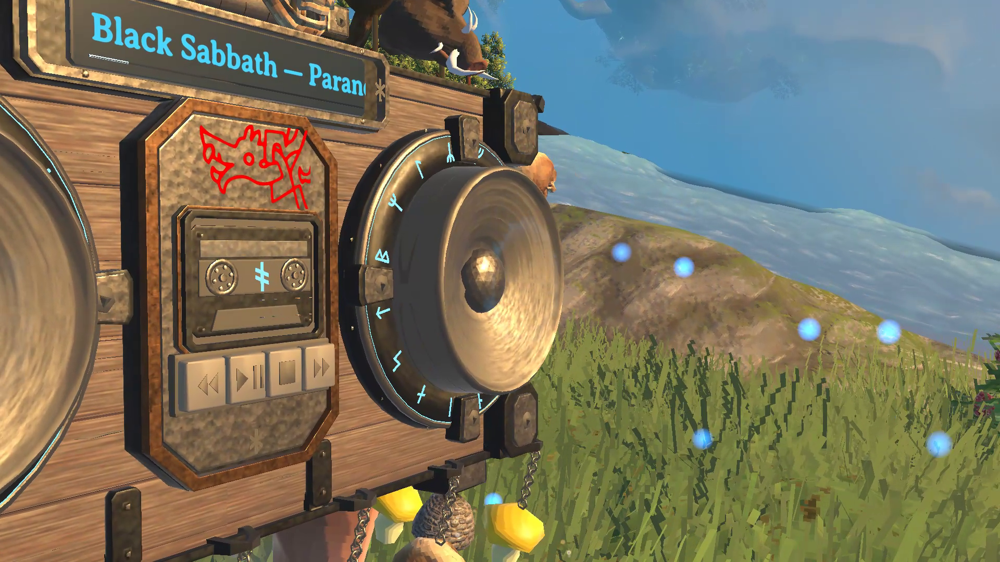

*Мембрана динамика во время воспроизведения.*

## Сохранить библиотеку и решить проблемы

### Дополнительная конфигурация

Основное управление находится в игровых меню. В конфигурации плагина также есть расширенные параметры аппарата и мира. Необязательный редактор конфигурации BepInEx может показать переведённые подписи и описания настроек мода. Если редактора нет, перед ручной правкой закройте игру и сохраните копию файла конфигурации из таблицы ниже.

| Раздел | Дополнительные параметры |
|---|---|
| Звук | Дальность слышимости размещённого аппарата, размер потокового буфера, пути программ декодирования и чувствительность к звуку компьютера (по умолчанию 1, диапазон 0,1–5). |
| Вид корпуса | Цвет и яркость свечения корпуса, рун и резьбы; цвет и пульсация узора. |
| Динамики и кассета | Ход мембран, размер и длительность фронтов динамиков, цвета знаков свойств кассеты. |
| Украшения | Сила свечения грибов, интервал и время жизни частиц в форме монет и продуктов. |
| Крепление на спине | Подгонка по телу, зазор для снаряжения, положение и поворот. |
| Развитие в мире | Материалы и станции рецептов, пределы уровней аппарата и кассеты, цены мест для украшений и баланс восстановления. |
| Физика брошенных предметов | Сила толчка, множитель радиуса, пределы массы и количества предметов, перерыв и максимальное изменение скорости. |

Это необязательные настройки. Для открытия меню и прослушивания музыки менять их не требуется. Требования крафта отражают локальные рецепты. Значения общих бонусов отражают настройки баланса хозяина мира.

Стандартные значения раздела `[World physics]`: `PressureImpulse = 20`, `RadiusMultiplier = 1`, `MaximumMass = 0`, `MaximumBodies = 0`, `PushCooldown = 1`, `MaxSpeedChange = 2`. Нулевые пределы массы и количества предметов означают отсутствие заданного ограничения. Перерыв указан в секундах, максимальное изменение скорости в метрах в секунду.

Если игровые действия вашего аппарата остаются выключены при разрешении сервера, проверьте также `MusicOnly` в разделе `[Gameplay]` локальной конфигурации. Значение true отключает игровые действия собственного аппарата, даже когда полученные правила мира их разрешают.

### Локальные файлы, язык и приватность

Каждый игрок слышит собственный звук. Музыкальные файлы и захват звука компьютера остаются локальными. По игровой сети передаются оформление аппарата и игровые данные. Всем участникам нужна одинаковая версия мода. Клиент без нужного мода получает штатный отказ подключения Valheim. Журнал сервера указывает требуемую версию.

Интерфейс следует выбранному языку Valheim. Английский и русский покрывают меню, предметы, подсказки и названия настроек. Для других языков используется английский, если перевода мода нет. Смена языка игры обновляет текст. Названия треков, пути папок и сохранённые настройки не меняются.

Мод не содержит музыки и не предоставляет прав на музыку для трансляций или видео.

### Пути и резервные копии

Пути отсчитываются от действующей установки BepInEx или профиля менеджера модов.

| Путь | Что хранится |
|---|---|
| `BepInEx/config/ValheimBoombox/library.json` | Добавленные папки, плейлисты и сохранённые сведения о треках. |
| `BepInEx/config/ValheimBoombox/catalog.json` | Результаты последнего завершённого поиска. |
| `BepInEx/config/ValheimBoombox/` | Прочее локальное состояние Boombox и резервные файлы. |
| `BepInEx/config/local.valheim.boombox.cfg` | Настройки плагина, включая пути декодеров и дополнительные клавиши. |
| `Tools/FFmpeg/` рядом с DLL плагина | Комплектные `ffmpeg.exe` и `ffprobe.exe`. |

Музыкальные файлы остаются в выбранных папках. Развитие аппарата, украшения и сведения кассеты также сохраняются в данных игрового предмета. Перед переносом установки или восстановлением закройте игру. Скопируйте каталог настроек Boombox, конфигурацию плагина, музыку и обычные сохранения персонажей и миров Valheim. Храните эти копии вместе. Перенос музыки в другое место может сделать старые записи плейлистов недоступными. Найдите музыку по новому пути, уберите отсутствующие записи и добавьте новые.

### Решить проблему

| Проблема | Что проверить |
|---|---|
| Мод не появился | Запустите профиль с модами. Проверьте BepInEx, полный установочный пакет и дубли DLL плагина. |
| Нет рецепта | Откройте ингредиенты. Проверьте станцию, её уровень, рецепты и пределы улучшений в локальной конфигурации. |
| Нет музыкальной кнопки в инвентаре | Получите магнитофон, чтобы персонаж знал его, затем откройте инвентарь заново. Extra Slots не нужен. |
| Ничего не играет | Вставьте кассету, наденьте или поставьте аппарат, включите воспроизведение и проверьте громкость с отключением звука. Убедитесь, что источник существует. |
| Трек недоступен | Верните прежний путь файла либо найдите музыку в новой папке и замените запись плейлиста. Храните CUE и нужное ему аудио вместе. |
| Ошибка декодирования | Используйте полный пакет с FFmpeg. При переносе программ проверьте `FFmpegPath` и `FFprobePath` в конфигурации. Расширение не гарантирует исправный кодек. |
| Поиск длится долго | Оставьте только нужные папки. **Отменить поиск** останавливает текущий поиск. |
| Нет реакции на звук компьютера | Запустите источник **Звук компьютера**, разрешите реакцию в **Папках** и проверьте стандартный мультимедийный выход Windows и громкость внешнего плеера. |
| Нет реакции на музыку игры | Проверьте, доступен ли сейчас музыкальный источник Valheim. |
| Не видно эффектов | Проверьте **Все эффекты в мире**, отдельные переключатели **Видимости**, яркость и активность выбранного источника. |
| Нет заряда | Наденьте собственный играющий аппарат, вставьте кассету, разрешите усиление и проверьте личные и общие игровые правила. Держите нужное снаряжение во время шагов заряда. |
| Нет бонусов | Проверьте ранги кассеты, назначение бонусов украшений, воспроизведение, дальность и правила хозяина. Ранг 0 не даёт вклада кассеты. |
| Не извлекается кассета | Освободите обычную ячейку рюкзака. |
| Аппарат не ставится на транспорт | Освободите опору рядом с персонажем. При отказе аппарат остаётся в рюкзаке. |
| Нет отдельной ячейки | Используйте обычные действия инвентаря. Установленная версия Extra Slots может не поддерживаться. |
| Сервер отклоняет подключение | Сопоставьте версию мода с сервером и найдите требуемую версию в его журнале. |

В сообщении об ошибке укажите версии игры и мода, другие моды, шаги, ожидаемый и фактический результат. Для визуальной проблемы добавьте снимок или короткое видео. Перед передачей журнала BepInEx уберите личные пути, идентификаторы аккаунтов и сведения о музыкальной библиотеке. Не публикуйте свою библиотеку и игровые сохранения.

### Дополнительные клавиши

Основное управление доступно через кнопки инвентаря. По умолчанию **F7** открывает меню, а **F4** включает воспроизведение или паузу. Обе клавиши можно изменить в конфигурации плагина. Команда консоли `boombox` тоже открывает меню.
