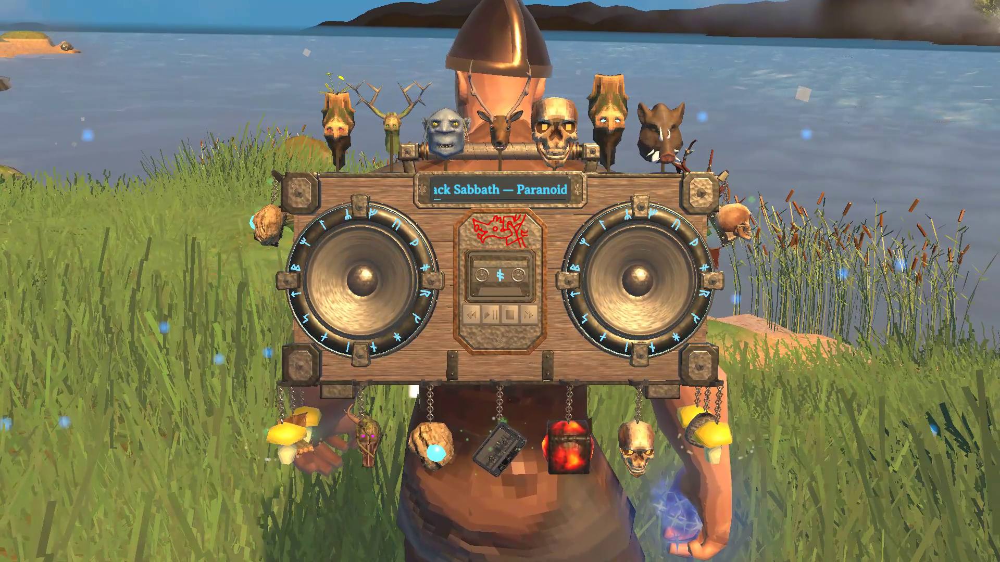

# Valheim Boombox

[English](README.md) · Windows x64 · 0.2.3 альфа · Автор **Rizias**

Носите свою музыку по миру Valheim. Включайте локальные треки и плейлисты, используйте звук других программ Windows и превращайте музыкальные события в боевые волны, заряд снаряжения и бонусы для игроков поблизости.

*Украшенный магнитофон во время воспроизведения.*

[Полное руководство игрока](PLAY.ru.md) описывает начало игры, каждое меню, все стандартные рецепты и решение проблем.

## Что можно делать

- Создавать и улучшать аппарат через восемь уровней. Развивать пять независимых свойств кассеты до ранга VII.
- Воспроизводить MP3, FLAC, WAV, OGG, APE, WV, M4A, AAC, Opus и WMA. Находить музыку в папках, ZIP и альбомах CUE. Искать треки, выбирать альбомы и собирать упорядоченные плейлисты с повтором.
- Реагировать на общий звук стандартного устройства Windows, музыку Valheim или фиксированный ритм. Анализ звука компьютера не дублирует, не записывает и не передаёт звук.
- Носить аппарат со свободными руками, ставить его в мире или перевозить на лодке и телеге.
- Заполнять 24 места подходящими головами трофеев, грибами, предметами и миниатюрами. Независимо от вида выбирать бонус и частицы каждого украшения.
- Заряжать лук, щит, ближнее оружие, посох или арбалет. Полный заряд инструментов по ресурсам и брошенных копий позволяет повторить попадание призрачным ударом. Музыкальные импульсы помогают лодке, когда носитель у руля.
- Делиться бонусами урона волн, здоровья, выносливости, эйтра и скорости. Смотреть вклад источников, выбирать личный режим «Только музыка» и менять общие правила от имени хозяина мира.
- Предварительно смотреть пять музыкальных эффектов, выбирать цвета, управлять 14 группами оформления и перемещать плеер с индикаторами бонусов.

Музыка остаётся локальной у каждого игрока. По сети передаются игровые данные и оформление. Английские и русские меню следуют языку Valheim. Поддерживаемая версия Extra Slots добавляет отдельную ячейку снаряжения.

## Установить и начать

1. Установите BepInExPack Valheim 5.4.2351 в профиль менеджера модов Valheim.
2. Импортируйте полный установочный ZIP через локальный импорт в Gale, r2modman или Thunderstore Mod Manager. Запустите игру с модами.
3. Создайте первый аппарат и обычную кассету на станции «Верстак» уровня 1. [Материалы перечислены в руководстве](PLAY.ru.md#установить-мод-и-включить-первый-трек).
4. В инвентаре нажмите правой кнопкой на кассету, чтобы вставить её, затем наденьте магнитофон.
5. Нажмите **Выбрать музыку**, откройте **Папки** и добавьте музыкальную папку. После поиска включите трек в **Библиотеке**.

Для ручной установки скопируйте дерево `BepInEx` из пакета в существующую установку BepInEx, сохраняя подпапки. Оставьте одну DLL плагина. ZIP исходного кода не является установочным пакетом. Полный пакет содержит FFmpeg, его исходники и материалы лицензии. Музыка в него не входит.

*В одной библиотеке можно выбрать источник, включить альбом или отметить треки для плейлиста.*

## Найти управление и рецепты

| Задача | Раздел руководства |
|---|---|
| Добавить музыку, просматривать альбомы, менять плейлисты или выбрать звук компьютера | [Библиотека](PLAY.ru.md#собрать-музыкальную-библиотеку) и [источники звука](PLAY.ru.md#выбрать-источник-звука). |
| Посмотреть все рецепты аппарата и кассеты | [Уровни аппарата](PLAY.ru.md#улучшить-аппарат) и [свойства кассеты](PLAY.ru.md#улучшить-кассету). |
| Открыть места, повторно использовать образцы и выбрать частицы | [Украшения](PLAY.ru.md#украсить-магнитофон). |
| Применить боевые волны, заряд, призрачные удары или помощь лодке | [Игровые эффекты](PLAY.ru.md#использовать-волны-и-заряд-снаряжения). |
| Посмотреть общие бонусы, переместить индикаторы и изменить баланс мира | [Бонусы и правила мира](PLAY.ru.md#получать-общие-бонусы-и-менять-правила-мира). |
| Посмотреть эффект, выбрать цвет и скрыть отдельные элементы | [Эффекты и видимость](PLAY.ru.md#настроить-эффекты-и-видимость). |
| Сохранить библиотеку, найти пропавшую музыку или сообщить об ошибке | [Пути и решение проблем](PLAY.ru.md#сохранить-библиотеку-и-решить-проблемы). |

*У украшений повторно используемые образцы, выбираемые бонусы и декоративные частицы.*

## Мультиплеер и совместимость

*Раздел «Бонусы» объясняет действие каждого эффекта и позволяет разместить его индикаторы на экране.*

Установите одинаковую версию на сервер и все клиенты. Клиент без нужного мода получает штатный отказ Valheim. Журнал сервера указывает требуемую версию. Хозяин управляет силой общих бонусов и радиусом. Рецепты и пределы улучшений берутся из локальной конфигурации каждой установки; сервер их не синхронизирует.

Это неофициальная альфа для Windows x64. Extra Slots необязателен. Совместимость со всеми другими модами инвентаря и снаряжения не гарантируется. Мод не предоставляет прав на музыку для трансляций или видео.

*Динамики, катушки кассеты и подсветка корпуса реагируют на воспроизведение. Управление видимостью отдельно от игровых действий.*
